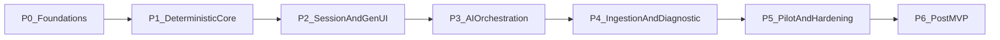

# PROJECT COGNITIVE OS
## Document 08: Delivery Phases
**Version:** 1.1 (2026-10-09: P6 notes the delivered multi-subject phases)  
**Scope:** MVP delivery of [EPIC-01](07-epics-user-stories.md) plus the post-MVP outlook.

---

### 1. Sequencing Principle

Ship the **deterministic core before any AI**. Each phase produces something a learner could use end to end on the seeded graph, so AI layers (Jev, System 2, Deep Research) are added on top of a working product rather than required for it. This also makes the rule-engine fallback the first thing built and the most tested.

Durations assume a team of 2–3 engineers plus part-time content/design support; treat them as estimates to re-plan after P1.

| Phase | Focus | Features | Est. duration |
| :--- | :--- | :--- | :--- |
| P0 | Foundations | F6 (seed), F9 (part) | 2–3 weeks |
| P1 | Deterministic Core | F1, F2 | 3 weeks |
| P2 | Session & GenUI | F3, F4 | 4 weeks |
| P3 | AI Orchestration | F5, F8 | 3 weeks |
| P4 | Ingestion & Diagnostic | F6 (pipeline), F7 | 4 weeks |
| P5 | Pilot & Hardening | F9 (rest), KPI pilot | 4 weeks + 30-day retention window |
| P6 | Post-MVP | New domains, B2B | Planned after P5 results |

---

### P0: Foundations

**Goal:** A deployable skeleton with the data model, auth, and a hand-built Algebra graph that later phases practice against.

**Stories:** US-6.1 (seed DAG + items), US-9.1 (auth), US-9.2 (age screen and consent, UI + data only), US-9.3 (account deletion).

**Scope:**
* Monorepo: `frontend/` (Next.js ≥ 16.3.6, Tailwind v4) and `backend/` (FastAPI, Python 3.12); CI running lint, type-check, tests.
* PostgreSQL 18 with the Doc 04 §2.1 schema, applied via migrations.
* ~20 Algebra nodes (linear equations → quadratics) with ≥ 10 SymPy-verified items each.
* i18n scaffolding (`en`, `es`) from the first screen.

**Exit criteria:**
* Schema migrations apply cleanly on an empty database; seed script is idempotent.
* Seed validation test passes: DAG acyclic, every item step verifies.
* A user can sign up, pass the age screen, sign in, and delete their account.

**Risks:** Item authoring takes longer than expected → start content work on day 1; templated items with randomized parameters reduce volume.

**Dependencies:** Managed auth provider and KMS chosen; legal input on consent flows started (long lead time).

---

### P1: Deterministic Core

**Goal:** Correct, fast step checking and memory scheduling with **no LLM involved**.

**Stories:** US-1.1, US-1.2, US-1.3, US-2.1, US-2.2, US-2.3 (rule mapping only).

**Scope:**
* SymPy worker pool with timeouts, input caps, numeric-sampling fallback, equation handling (Doc 04 §4).
* AST operation checks for the 5 MVP operations.
* FSRS-6 via py-fsrs wrapped behind one service; due-queue query.
* `POST /api/v1/session/evaluate-step` returning verdicts from the rule engine.

**Exit criteria:**
* SymPy evaluation P95 < 200 ms at 50 concurrent submissions (bench script).
* 100% of seeded item steps verify; the equivalence test suite passes (including `2x=6` vs `x=3`, sign errors, timeouts).
* FSRS wrapper output matches py-fsrs for a fixed review history.

**Risks:**
* `parse_latex` gaps on MathLive's LaTeX output → build a golden set of MathLive outputs early; normalize LaTeX before parsing.
* `simplify` slow on some expressions → numeric sampling path and 150 ms timeout.

**Dependencies:** P0 schema and seeded items.

---

### P2: Session & GenUI

**Goal:** A complete daily practice session on the seeded graph using only the rule engine.

**Stories:** US-3.1 to US-3.6, US-4.1 to US-4.5.

**Scope:**
* `WorkspaceRenderer` + registry + Zod contract; all 6 widgets.
* Session runner: accuracy band + scaffold matrix, hint ladder with **templated** hints (no System 2 yet), micro-break timer, post-session rest, daily plan within budget.
* Path screen showing the seeded DAG and progress.

**Exit criteria:**
* A tester completes a full session on a mid-range Android phone: due reviews → new node → micro-break → post-session rest, with FSRS state updated.
* GenUI render P95 < 30 ms after data arrives; 60 fps during keyboard input.
* Scaffold matrix test covers every cell; `RestOverlay` fires `onComplete` exactly once.
* axe clean on session and path screens; keyboard targets ≥ 48×48 px.

**Risks:** MathLive virtual keyboard layouts don't fit usability needs → quick hallway test in week 1 of P2 before styling work.

**Dependencies:** P1 evaluate-step endpoint.

---

### P3: AI Orchestration

**Goal:** Better error classification and real Socratic hints, without making the product depend on AI availability.

**Stories:** US-5.1, US-5.2, US-5.3, US-5.4, US-8.1.

**Scope:**
* Jev Decisions API client (`typesafe/jev-1.13`, pinned) with confidence policy and circuit breaker.
* System 2 hints (DeepSeek V4.1 Flash, fallback GLM 5.3 Flash) with the answer-leak check and templated fallback.
* Quick Socratic mode.
* Cost aggregation into `session_logs.llm_cost_usd`.

**Exit criteria:**
* Jev P95 latency **measured** in production-like conditions. If > 150 ms, either accept a revised target in Doc 02 or call Jev asynchronously (render the SymPy result first and apply the Jev decision to the next step).
* Confidence thresholds tuned on ≥ 200 labeled attempts; Jev verdict agreement with human labels ≥ 85%.
* Answer-leak check blocks 100% of a red-team set of 50 leaking hints.
* Fallback test: with Jev disabled, sessions complete with no user-visible errors.

**Risks:**
* Jev latency or accuracy insufficient for math error types → rule engine is already the default; Jev becomes an enhancement.
* Model deprecations on OpenRouter → model IDs in one config file; pin versions.

**Dependencies:** P2 session runner; OpenRouter account and spend limits.

---

### P4: Ingestion & Diagnostic

**Goal:** Any Algebra/Pre-Calc goal becomes a verified, personalized path with a short diagnostic.

**Stories:** US-6.2 to US-6.7, US-7.1, US-7.2.

**Scope:**
* Optimistic draft (< 1.5 s) matched to existing nodes; SSE stream with resume.
* Deep Research over allowlisted licensed sources; DAG compiler; attribution storage.
* Item generation with SymPy verification.
* KST diagnostic (3–5 probes) writing `p_mastery` and the frontier.
* Syllabus upload (not for minors).

**Exit criteria:**
* Draft P95 < 1.5 s; `graph_complete` within 5 minutes for a typical goal.
* On 10 benchmark goals, a human reviewer rates ≥ 90% of generated prerequisite edges as correct.
* ≥ 80% of generated items pass SymPy verification on first draft (otherwise improve prompts before scaling).
* Diagnostic tests pass; median diagnostic length ≤ 5 probes.

**Risks:**
* Graph quality varies by goal → reuse seeded nodes wherever they match; human review queue for removed cycle edges.
* Licensing restricts sources → OpenStax + Common Core cover secondary/college Algebra and Pre-Calc.

**Dependencies:** P3 System 2 client (used for drafts and item generation).

---

### P5: Pilot & Hardening

**Goal:** Production readiness and the first measured evidence for the KPIs.

**Stories:** US-9.4, US-9.5, US-9.6, US-9.7, US-9.8, US-9.9; consent flow completion for US-9.2.

**Scope:**
* Offline sessions (IndexedDB, sync queue, server re-evaluation), PWA install, performance budgets.
* Spanish copy complete; dashboards and alerts.
* BYO API key.
* KPI pilot per [Doc 02 §7](02-product-requirements.md#7-kpi-measurement-protocol), including a micro-break comparison.

**Exit criteria:**
* All NFRs in Doc 02 §5 met on dashboards for 2 consecutive weeks.
* Offline test: airplane mode mid-session, 10 steps, reconnect → no lost attempts, server state authoritative.
* Legal sign-off on privacy/consent for launch markets.
* Pilot report published internally: time-to-mastery and 14/30-day retention vs. control with confidence intervals; Claim Register evidence levels updated.

**Risks:**
* Pilot underpowered → frame results as directional; plan a larger follow-up.
* KPI targets missed → treat as product input for P6 priorities, not as a launch blocker unless learners are worse off than control.

**Dependencies:** P4 complete; pilot participants recruited (start recruiting during P3).

---

### P6: Post-MVP (outlook)

Prioritized after P5 results. Each item is its own epic with its own discovery.
* **Multi-subject (delivered 2026-10-09):** subject profile, grader registry, core components, humanities / language / science / code packs and cited web research shipped as Doc 11 phases 1–5 ([Doc 10](10-multi-subject-spec.md)). The DevOps and Language items below remain for their *deep* versions (server sandboxes, phoneme feedback).
* **Math depth:** Calculus and Linear Algebra graphs (Elena's needs), probabilistic KST (BLIM) diagnostic, IRT item calibration.
* **DevOps engine:** ephemeral sandboxes (Firecracker/Docker) with deterministic task checks.
* **Language engine:** speech pipeline and phoneme-level feedback.
* **B2B:** multi-tenant portals, SSO, team analytics.
* **Business model:** compute credits and pay-per-mastery verified assessments.

---

### 2. Phase to Story Map

| Phase | Stories |
| :--- | :--- |
| P0 | US-6.1, US-9.1, US-9.2 (data + UI), US-9.3 |
| P1 | US-1.1, US-1.2, US-1.3, US-2.1, US-2.2, US-2.3 |
| P2 | US-3.1, US-3.2, US-3.3, US-3.4, US-3.5, US-3.6, US-4.1, US-4.2, US-4.3, US-4.4, US-4.5 |
| P3 | US-5.1, US-5.2, US-5.3, US-5.4, US-8.1 |
| P4 | US-6.2, US-6.3, US-6.4, US-6.5, US-6.6, US-6.7, US-7.1, US-7.2 |
| P5 | US-2.4, US-9.2 (consent completion), US-9.4, US-9.5, US-9.6, US-9.7, US-9.8, US-9.9 |
