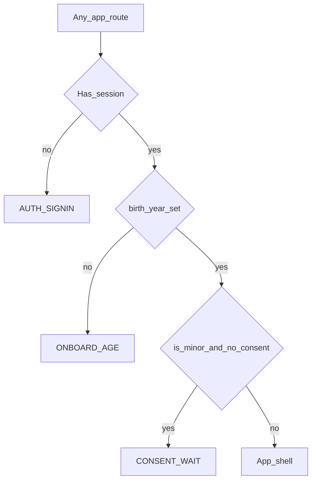

# PROJECT COGNITIVE OS (Pegazus)
## Document 09: UI / UX Specification
**Version:** 1.2 (multi-subject; see §12.7, §20)  
**Internal product key:** Pegazus (public marketing name deferred)  
**Scope:** Every learner-facing and essential ops-adjacent screen for MVP (EPIC-01), including states, flows, GenUI widgets, accessibility, and i18n.  
**Sources:** [Doc 02](02-product-requirements.md), [Doc 03](03-cognitive-engine-pedagogical.md), [Doc 06](06-frontend-architecture-genui.md), [Doc 07](07-epics-user-stories.md), [Doc 08](08-delivery-phases.md).  
**Companion:** Doc 06 owns component *implementation*; this document owns *what the product looks and feels like*, screen by screen.

---

### 1. Purpose & how to use this doc

This is the single UI/UX source of truth for design and frontend work. Designers and engineers should be able to build any screen from these sections without inventing new patterns mid-flight.

| If you need… | Go to |
| :--- | :--- |
| Visual language, type, color, motion | §2 Design system |
| Where screens live and how you navigate | §3 Information architecture |
| Exact screens and layouts | §4–§11 Screen inventory |
| GenUI widgets inside the session | §12 Widget UX |
| Loading / empty / error / offline | §13 Global states |
| a11y, touch, reduced motion | §14 Accessibility & interaction |
| en / es | §15 Localization |
| What ships when | §16 Phase mapping |
| Story ↔ screen trace | §17 Traceability |

**Non-goals of the UI:** streaks, XP vanity, energy meters, leaderboards, confetti for wrong answers, chat-first tutoring, nested GenUI trees.

---

### 2. Design system

#### 2.1 Product personality

Pegazus should feel like a **calm instrument**, not a game and not a textbook PDF.

* **Quiet confidence:** dark slate field, sparse chrome, math as the hero.
* **One job per screen:** practice, plan, rest, or set up—never all at once in the first viewport.
* **Brand first on entry surfaces:** on splash / home / path overview, the word **Pegazus** is a hero-level signal (wordmark or large title), not a tiny nav label. Supporting headlines stay secondary to the brand.
* **No dark patterns:** rest skips are honest; progress is mastery and due reviews, not fake points.

Preserve the Doc 06 token set (do not invent a cream/serif or purple-marketing look).

#### 2.2 Color tokens (from Doc 06)

| Token | Hex | Role |
| :--- | :--- | :--- |
| `background` | `#090D16` | App canvas |
| `surface` | `#0F172A` | Panels, sheets |
| `surface-subtle` | `#1E293B` | Nested rows, chips |
| `surface-accent` | `#334155` | Borders, dividers |
| `neuro-indigo` | `#6366F1` | Primary action, focus, active step |
| `neuro-teal` | `#14B8A6` | Success, mastery, secondary accent |
| `neuro-alert` | `#F43F5E` | Errors, destructive confirm |
| Slate text ramp | `slate-100` … `slate-500` | Primary → muted copy |

Semantic mapping:

* **Correct step:** teal check, subtle teal border—no celebration animation.
* **Incorrect step:** alert icon + calm copy; never shake the whole screen.
* **Focus / active input:** indigo ring at 50% opacity.
* **Disabled:** 40% opacity; still ≥ 48×48 hit area if interactive when enabled.

#### 2.3 Typography

| Role | Spec | Notes |
| :--- | :--- | :--- |
| Brand / display | Distinctive sans or soft geometric, 28–40 px, semibold | Pegazus wordmark; avoid Inter/Roboto/Arial/system as *display* |
| Screen title | 22–28 px, semibold, slate-100 | One per screen |
| Body | 15–16 px, regular, slate-300/400 | Line length ≤ ~60 ch on desktop |
| Math UI labels | Mono 11–12 px, uppercase tracking-wider, slate-500 | “Symbolic Derivation”, step indices |
| Buttons | 13–14 px, medium | Sentence case in en/es, not ALL CAPS except micro-labels |

Math content (KaTeX / MathLive) always outweighs surrounding chrome in size.

#### 2.4 Spacing, radius, elevation

* Base unit **4 px**; common gaps 8 / 12 / 16 / 24.
* Practice workspace content max-width **`max-w-xl` (~36 rem)** centered on tablet+.
* Radius: controls `rounded-lg` (8), panels `rounded-2xl` (16), rest breath circle full.
* Elevation: prefer **border + surface**, not multi-layer shadows. One soft shadow max on floating sheets (hint drawer, dialogs).

#### 2.5 Iconography & imagery

* Prefer sparse line icons (16–20 px) for nav and status only.
* No emoji in product UI.
* No floating promo badges, stickers, or stats chips overlaid on hero media.
* Path visualization is the primary “visual anchor” for plan screens (real graph, not abstract blobs).

#### 2.6 Motion

Ship **2–3 intentional motions** product-wide; everything else is instant or simple fade.

1. **`breathe`** on `RestOverlay` (10 s cycle default; `motion-safe` only; static under `prefers-reduced-motion`).
2. **Step status cross-fade** (✓ / ✗ appear ≤ 150 ms opacity).
3. **Sheet enter** for hint drawer and dialogs (translate-Y 8 px + fade, ≤ 200 ms).

No parallax, no continuous background particle fields, no confetti.

#### 2.7 Layout chrome (AppShell)

Persistent on authenticated app screens (not on rest overlays, priming, or full-screen dialogs):

```
┌─────────────────────────────────────────┐
│  Pegazus          [locale] [account]    │  top bar, 56 px min
├─────────────────────────────────────────┤
│                                         │
│           page content                  │
│                                         │
├─────────────────────────────────────────┤
│  Home · Path · Practice · Ask           │  bottom nav (mobile)
└─────────────────────────────────────────┘
```

* **Mobile (< md):** bottom tab bar, 4 destinations max (Home, Path, Practice/Continue, Ask).
* **Desktop (≥ md):** left rail or top links; same destinations; content column centered.
* Safe areas respected (`env(safe-area-inset-*)`) for PWA install on notched phones.
* Touch targets ≥ **48×48 px** everywhere (NFR 5.2).

---

### 3. Information architecture

#### 3.1 Route map (locale-prefixed)

All routes live under `/[locale]/…` with `locale ∈ {en, es}`.

| Route | Screen ID | Journey |
| :--- | :--- | :--- |
| `/[locale]` | HOME | Hub |
| `/[locale]/signin` | AUTH_SIGNIN | J0 |
| `/[locale]/auth/callback` | AUTH_CALLBACK | J0 |
| `/[locale]/age` | ONBOARD_AGE | J0 |
| `/[locale]/settings` | SETTINGS | Platform |
| `/[locale]/settings/delete` | SETTINGS_DELETE | US-9.3 |
| `/[locale]/settings/api-key` | SETTINGS_BYO | US-9.4 |
| `/[locale]/path/new` | PATH_CREATE | J2 |
| `/[locale]/path/[id]` | PATH_VIEW | J2 / J3 |
| `/[locale]/path/[id]/diagnostic` | DIAGNOSTIC | J2 |
| `/[locale]/session/[id]` | SESSION | J3 |
| `/[locale]/session/[id]/summary` | SESSION_SUMMARY | J3 |
| `/[locale]/session/[id]/rest` | SESSION_REST | J3 |
| `/[locale]/ask` | SOCRATIC | J1 |
| `/[locale]/offline` | OFFLINE_BANNER | US-9.5 (component + optional page) |

Install / splash is PWA chrome, not a separate marketing site in MVP.

#### 3.2 Primary navigation destinations

| Tab | Goes to | Empty / fallback |
| :--- | :--- | :--- |
| Home | HOME | — |
| Path | last ACTIVE path, else PATH_CREATE | CTA to create |
| Practice | resume active session or start today’s plan | CTA “Start session” |
| Ask | SOCRATIC | — |

Account / settings via avatar or gear in the top bar—not a fifth tab.

#### 3.3 Auth gates (order)



`CONSENT_WAIT` is a blocking screen (MVP: honest “account pending guardian consent” for Mexico market age rules when legal copy is ready; until then soft gate stores year only—see §5).

---

### 4. Screen inventory — Auth & onboarding (J0)

#### 4.1 AUTH_SIGNIN — Sign in

**Goal:** Passwordless entry in under 30 seconds (US-9.1).

**Layout (mobile-first, one composition):**

* Full-bleed deep background (subtle radial gradient from indigo/20 at top → background).
* **Pegazus** wordmark large, top-third.
* One short line: e.g. “Mastery practice, not busywork.”
* Primary block: email field + “Email me a link” / “Send code”.
* Secondary: “Continue with Google” / “Continue with Apple” (when providers enabled).
* Locale switcher top-right (en | es).
* Footer: privacy one-liner linking to policy (placeholder until legal).

**States:**

| State | UI |
| :--- | :--- |
| Idle | Email + CTA enabled when email valid |
| Sending | CTA spinner; field disabled |
| Sent | Replace form with “Check your email” + resend (cooldown 60 s) |
| Invalid email | Inline field error |
| Rate limited | Calm alert: try again later |
| Provider error | Toast + stay on page |

**UX rules:** No password fields. No “create account vs login” fork—magic link covers both. Desktop: same composition, max-width ~420 px centered—not a marketing dashboard.

#### 4.2 AUTH_CALLBACK — Completing sign-in

Minimal: Pegazus mark + “Signing you in…” + progress. On failure: message + link back to AUTH_SIGNIN.

#### 4.3 ONBOARD_AGE — Profile setup (`/[locale]/age`)

**Goal:** Capture a light profile in one calm flow (US-9.2 + settings foundation). No guilt copy.

**Layout (stacked field panels, not bare inputs):**

* Eyebrow: “Profile setup” / “Tu perfil”
* Title: “A few details about you”
* Supporting: personalization + age rules by country; development disclaimer
* **Display name:** large text field, nickname autocomplete, char count
* **Birth year:** decade chips + year grid (no free-typed year); selected year shown large
* **Country:** searchable chip grid; **Mexico featured**; ISO codes stored
* **Locale:** English / Español segmented control
* Primary CTA: Save and continue

**Logic:** Require `display_name`, `birth_year`, `country_code`. Compute `is_minor` from year (Mexico consent age later). Adults → HOME. Minors → CONSENT_WAIT when legal copy exists (dev: soft continue).

#### 4.4 CONSENT_WAIT — Guardian consent pending

* Brand + clear status.
* What is blocked: BYO keys, uploads, activation of practice (per Doc 04).
* CTA: “I’ve sent the guardian email” / “Sign out”.
* Legal text slots for counsel; do not invent COPPA wording in engineering.

---

### 5. Screen inventory — Home & settings

#### 5.1 HOME — Today hub

**Goal:** Answer “what should I do in the next 45 minutes?” in one glance.

**First viewport (hero budget):**

1. Pegazus brand.
2. One headline: greeting or “Today’s practice”.
3. One supporting sentence: due reviews count + budget remaining, or “Create a path to start”.
4. One CTA group: **Continue session** or **Start today’s session** / **Create learning path**.
5. No stats strip, no schedule collage, no cards for decoration.

**Below fold (scroll):**

* Active path name + progress toward deadline (text + simple bar).
* Next frontier node title (KaTeX if equation).
* Optional: last session one-liner (“Yesterday: 32 min · 4 nodes reviewed”).

**Empty (no path):** brand + CTA Create path + secondary Ask a quick question.

**Loading:** skeleton for CTA block only—not a dashboard of placeholders.

#### 5.2 SETTINGS

Sections (stacked list, not cards-for-cards’ sake):

1. **Profile:** email (read-only), locale (`en`/`es`), preferred session duration (mins).
2. **Study:** target retention (advanced, default 0.90), micro-break interval (5–7 min), optional focus priming toggle (off by default).
3. **API key (BYO):** link to SETTINGS_BYO; hidden/disabled for minors.
4. **Privacy:** Delete account → SETTINGS_DELETE.
5. **About:** Pegazus build/version, open-source attributions link, license note for content.

Sign out at bottom, destructive styling secondary to Delete.

#### 5.3 SETTINGS_BYO — Bring your own OpenRouter key (US-9.4)

* Explain: key stays encrypted; never shown again after save.
* Password-style input + Show once.
* CTA: Save & test (runs validation call).
* Success: “Key works” teal status; Remove key secondary.
* Errors: invalid key, network, minor blocked.

#### 5.4 SETTINGS_DELETE — Delete account (US-9.3)

Two-step:

1. Explain hard delete of learning data within 30 days; confirmation email.
2. Type email or phrase “DELETE” (locale-appropriate) to enable destructive button.
3. Success → signed out → AUTH_SIGNIN with “Account scheduled for deletion”.

---

### 6. Screen inventory — Learning path (J2)

#### 6.1 PATH_CREATE — Create learning path

**Goal:** Capture goal + constraint in one focused form (US-6.2, US-6.7).

**Fields:**

| Field | Required | UI |
| :--- | :--- | :--- |
| Goal / subject | Yes | Multiline, placeholder examples in locale |
| Target date | One of date/budget | Date picker |
| Daily budget (mins) | One of date/budget | Stepper 15–120 |
| Syllabus upload | No | PDF/text ≤ 10 MB; disabled for minors |

Validation: if neither date nor budget → inline error under constraint group.

**CTA:** Create path → optimistic navigate to PATH_VIEW in drafting state.

**UX:** One column; no parallel promo panels. Upload is a quiet secondary control, not a hero dropzone collage.

#### 6.2 PATH_VIEW — Living path

**Goal:** Show the DAG critical path, milestones, attributions, and readiness to practice (US-6.3, US-6.5, US-4.5, US-7.2).

**Regions:**

1. **Header:** Pegazus sub-branding optional; path title; status chip (`DRAFTING` / `ACTIVE` / …); Edit constraints.
2. **Refining banner** (when Phase 2 running): “Refining graph…” indeterminate progress; not blocking Start if draft nodes exist.
3. **Graph canvas:** vertical or left-to-right DAG of modules/nodes.
   * Node states: locked, frontier, mastered, due review, drafting.
   * Tap node → bottom sheet: title, description, source attribution, mastery %, due date.
4. **Critical path summary:** estimated total minutes; fit-to-deadline warning if plan no longer fits (US-4.5) with suggested new daily budget.
5. **Primary CTA:** Start diagnostic (if not done) or Start today’s session.
6. **Attribution footer:** collapsible list of `source_attribution` / licenses.

**SSE updates:** nodes morph in place (draft → validated) without resetting scroll or selection (US-6.3).

**Desktop:** graph left / detail right. **Mobile:** graph full width; detail as sheet.

#### 6.3 DIAGNOSTIC — Adaptive baseline (US-7.1, US-7.2)

**Goal:** 3–5 probes, then show frontier—no fatigue.

**Chrome:** progress “Question 2 of ~5” (tilde until capped); no score theatricality.

**Body:** same GenUI workspace as practice (step editor + keyboard)—diagnostic is practice-shaped, not multiple choice.

**Between probes:** brief calm transition (fade), no “Correct! +100”.

**End state:** summary—“Your starting point” + frontier node names + CTA Go to path / Start session.

---

### 7. Screen inventory — Daily session (J3)

Session UI is the product’s core. Cognitive load of chrome must stay below the math.

#### 7.1 SESSION — Deliberate practice workspace

**Layout (mobile):**

```
┌─────────────────────────────┐
│ ←  Node title     12:42 left│  thin top: exit, node, budget clock
├─────────────────────────────┤
│ Mode: Review | New          │  subtle text, not tabs circus
├─────────────────────────────┤
│                             │
│   GenUI widgets (ordered)   │  FadedWorkedExample / StepEditor /
│                             │  Plotter / Dialogue as payload says
│                             │
├─────────────────────────────┤
│   VirtualMathKeyboard       │  docks above home indicator
└─────────────────────────────┘
```

**Rules:**

* Due reviews before new frontier (US-2.2)—surface as quiet “Review” label, not a guilt banner.
* Scaffold level drives whether Faded vs blank editor appears (US-3.4, US-4.1)—learner does not pick scaffold.
* Hint drawer opens only after failed submit (US-3.6, US-4.2); one hint at a time; no chat composer.
* Micro-break triggers **after step submit** when active time ≥ threshold—not mid-keystroke (US-4.3).
* Exit (←): confirm if mid-item (“Progress on this item is saved / not saved” per offline rules).

**Feedback after submit:**

| Verdict family | UI |
| :--- | :--- |
| Step verified | Teal check on step; advance / unlock next |
| Wrong / sign error / structure | Alert mark; SocraticDialogueBox; stay on step |
| Timeout / input too long | Inline error; retry; no hint ladder increment for infra failures |
| Offline queued | Amber “Saved offline—will recheck when online” |

**Top budget clock:** remaining planned minutes; turns muted amber at < 5 min; does not interrupt mid-step.

#### 7.2 Focus priming (optional modal) — FocusPrimingModal

* Off by default (settings).
* Full-screen dim + single fixation target; Skip always available.
* 120 s default; no audio.

#### 7.3 RestOverlay — Micro-break (modal, global)

See Doc 06 §4.1. Full-screen; breath circle; “Look away…”; Skip → confirm dialog with neutral consolidation copy (no false “40%” claims). Guarantees single `onComplete`.

#### 7.4 SESSION_SUMMARY

**Goal:** Close the work bout before rest.

**Content:**

* Duration active, items completed, reviews done, frontier advanced (plain numbers—not gamified).
* Optional: nodes whose due dates moved (list).
* CTA: Continue to rest (primary). Secondary: Skip rest (logs; still encouraged).

No share sheet, no streak.

#### 7.5 SESSION_REST — Post-session wakeful rest (US-4.4)

* Low stimulation: brand, short instruction, timer (5–10 min default).
* Optional NSDRPlayer: native audio controls, transcript link, **never autoplay**.
* One-tap “I’m done—return home” override (logs early exit).
* After rest: HOME or PATH_VIEW.

---

### 8. Screen inventory — Quick Socratic (J1, US-8.1)

#### 8.1 SOCRATIC — Ask

**Goal:** Unblock one question without touching the long-term graph.

**Layout:**

1. Pegazus + title “Quick Socratic”.
2. Input: multiline plain text / optional LaTeX toggle; placeholder examples.
3. CTA: Ask.
4. Result canvas: GenUI payload (steps + one SocraticDialogueBox); follow-up field; **max 3 exchanges**.
5. Banner: “This won’t change your learning path.”

**OFF_TOPIC:** polite refusal, no canvas.

**End:** Discard / Done → HOME. No FSRS writes.

---

### 9. Ops-adjacent UI (minimal MVP)

Learner app does **not** ship a full admin console in P0–P5. Ops needs:

| Surface | Form | Notes |
| :--- | :--- | :--- |
| Latency / pedagogy / cost dashboards | External (Grafana or similar) linked from Doc 04 §7 | US-9.8; not in AppShell |
| Seed validation | CLI / CI | Not a screen |
| KPI pilot | Spreadsheet / dashboard outside app | US-9.9 |

If a thin **Ops link** appears in settings for internal builds only, gate behind env flag—never for learners.

---

### 10. Empty, loading, error, offline (cross-cutting)

#### 10.1 Empty patterns

| Context | Message intent | CTA |
| :--- | :--- | :--- |
| No path | Start by creating a goal | Create path |
| Path drafting, no nodes yet | Still outlining… | Wait / notify |
| No due + no frontier | You’re caught up for today | Ask / Rest |
| Graph fetch fail | Couldn’t load your path | Retry |

Tone: adult, short, no jokes about failure.

#### 10.2 Loading

* Prefer **local skeletons** matching final layout height (reduce CLS).
* Session: keep keyboard docked; pulse only the widget stack.
* Never block the whole app with a branded splash longer than first paint needs.

#### 10.3 Errors

* Inline for field/step errors.
* `role="alert"` for GenUI payload failure (“Could not load this exercise.”) + Retry.
* Full-page only for unrecoverable auth/session loss.

#### 10.4 Offline (US-9.5)

* Persistent slim banner: “Offline—practice continues; sync when back.”
* Disable path creation / diagnostic / Ask if those need network; keep SESSION if node payload cached.
* Sync conflict: server result wins; toast when a queued grade changes.

---

### 11. PWA & system UI (US-9.6)

* Manifest name: **Pegazus**; short_name Pegazus; theme/background = `background` token; display standalone.
* Install prompt: browser-native; optional quiet tip on HOME once (“Install for faster start”)—dismissible, not a modal trap.
* Dark mode default; mirror system only if we later add light (not MVP).
* FCP target < 1.2 s on emulated 4G—UI must not ship hero video or huge font files beyond two families.

---

### 12. GenUI widget UX detail

Widgets render in **payload order**, flat list only (Doc 04 §3, Doc 06 §2).

#### 12.1 SymbolicStepEditor

* Locked steps: KaTeX + MathML; muted surface.
* Active step: MathLive field, indigo border treatment.
* Submit: Enter or keyboard ⏎ only.
* Status icons labeled for AT (“Correct” / “Incorrect”).
* Do not auto-advance focus in a way that steals the keyboard mid-hint.

#### 12.2 VirtualMathKeyboard

* Algebra layout per Doc 06 §3.3.
* Keys ≥ 48×48; theme via MathLive CSS variables to Pegazus tokens.
* Optional haptic `vibrate(10)`—ignore failures.
* Hides OS keyboard when math field focused (MathLive config).

#### 12.3 FadedWorkedExample

* Statement in MathText above steps.
* Scaffold 1: gaps inline; Scaffold 2: prior steps locked with optional justification; Scaffold 3: delegates to blank SymbolicStepEditor.
* Justifications are secondary text (slate-400), never competing with the equation.

#### 12.4 FunctionPlotter

* SVG plot; sliders under graph; 60 fps redraw target.
* SR text alternative listing intercepts/asymptotes.
* No 3D, no WebGL required for MVP.

#### 12.5 SocraticDialogueBox

* Single plain-text prompt ≤ 240 chars; `aria-live="polite"`.
* Optional highlight on `highlightElementId`.
* No user chat box in practice mode; in Ask mode, follow-ups are a separate composer above the exchange cap.

#### 12.6 RestOverlay

* Documented in §7.3 / Doc 06; treat as system modal above Session.

**Invalid payload:** no widgets; alert + telemetry; runner may request refresh (US-3.1).

#### 12.7 Multi-subject widgets (v1.2)

§12.1–12.4 are the **math pack** (shown only when the subject profile's `notation` is `math`). Every other subject uses the core components and family packs of [Doc 10 §4](10-multi-subject-spec.md); shared rules:
* **Answer bar by grader:** text input for `exact` / `rubric_llm`; MathField only for math notation; selection widgets (QuickCheck, MatchPairs, OrderSteps, Categorize, Cloze, …) own their submit. Right/wrong is shown only after the server verdict; partial credit shows a score ring plus `feedback`.
* **Keyboard path for every widget:** drag interactions (OrderSteps, Categorize) have a select-then-move mode; Flashcards flip is a button; Pronunciation and AudioClip degrade to self-rating / hide without Web Speech support and never block progress.
* **Code:** CodeExercise runs in a Pyodide / JS worker with a timeout; a "beta" chip marks items whose reference solution has not yet passed in a browser.
* **Sources:** teach beats and the path outline list the node's research sources (title + external link, "opens in a new tab"); SourceExcerpt links only a cited URL. No other link is rendered from AI text.
* Every new widget's markup is in `frontend/scripts/axe-fixture.html` (`npm run axe:smoke`).

---

### 13. Feedback & pedagogy UX rules (non-negotiable)

1. **Never grade with celebration noise**—correct is quiet teal.
2. **Hints escalate by code tier**, not by user requesting “harder hint” (US-4.2).
3. **No self-rated FSRS buttons**—grades derived from attempts (US-2.3).
4. **Rest is first-class UI**, not a toast.
5. **AI downtime:** practice continues with rule-engine feedback; optional amber “Smart hints paused” (US-5.2)—session never blocks on LLM.
6. **Answer leak:** if hint rejected, show templated fallback without apologizing verbosely.

---

### 14. Accessibility & interaction

| Requirement | Spec |
| :--- | :--- |
| Touch targets | ≥ 48×48 px |
| Contrast | Body text ≥ WCAG AA on background/surface |
| Keyboard | Desktop: full session usable without mouse; focus rings visible (indigo) |
| Screen readers | MathML via KaTeX `htmlAndMathml`; status icons named; live regions for hints |
| Reduced motion | No breathe animation; instant sheet appear |
| Language | `lang` on `<html>` matches locale |
| Forms | Labels tied to inputs; errors linked with `aria-describedby` |
| Dialogs | `role="dialog"` + `aria-modal`; focus trap; Esc closes where skip allowed |
| axe | Clean on every touched screen (DoD) |

---

### 15. Localization (US-9.7)

* All chrome strings in `messages/en.json` and `messages/es.json`.
* Locale switcher on sign-in and in settings; persist `users.locale`.
* Dates/numbers: use locale-aware formatting.
* Math notation stays standard LaTeX (not translated).
* Socratic / System 2 prompts requested in learner locale.
* Spanish is first-class—not an afterthought string dump. Run layout QA for longer es strings (buttons, banners).

**Copy tone (both locales):** second person, short sentences, respectful, no slang that blocks Mexico Spanish, no false scientific precision.

---

### 16. Phase mapping (what UI to build when)

| Phase | Screens / widgets to ship |
| :--- | :--- |
| **P0** | AUTH_*, ONBOARD_AGE, HOME (stub graph list OK), SETTINGS_DELETE, locale switch, AppShell skeleton |
| **P1** | No new screens; SESSION can be API-only harness if needed |
| **P2** | SESSION full GenUI set, RestOverlay, SESSION_SUMMARY, SESSION_REST, PATH_VIEW read-only on seed, FocusPrimingModal optional |
| **P3** | SOCRATIC; live hints in SESSION; AI-paused banner |
| **P4** | PATH_CREATE, PATH_VIEW live SSE, DIAGNOSTIC, upload control |
| **P5** | SETTINGS_BYO, offline banner + sync toasts, PWA install tip, CONSENT_WAIT hardened, polish a11y |

Design exploration (brand illustration, motion studies) may run parallel from P0 but must not block P0-lite Docker auth.

---

### 17. Traceability (stories → screens)

| Story | Primary UI |
| :--- | :--- |
| US-3.1–3.6 | SESSION widgets |
| US-4.1–4.5 | SESSION, RestOverlay, SESSION_SUMMARY, SESSION_REST, PATH_VIEW warnings |
| US-5.2–5.3 | SESSION hint drawer + AI-paused |
| US-6.2–6.5, 6.7 | PATH_CREATE, PATH_VIEW |
| US-7.1–7.2 | DIAGNOSTIC, PATH_VIEW frontier |
| US-8.1 | SOCRATIC |
| US-9.1–9.3 | AUTH_*, ONBOARD_AGE, SETTINGS_DELETE |
| US-9.4 | SETTINGS_BYO |
| US-9.5–9.6 | Offline banner, PWA |
| US-9.7 | All screens via catalogs |

---

### 18. Wireframe-level checklist (acceptance for design handoff)

For each screen in §4–§8, deliverable is complete when it specifies:

1. Purpose in one sentence  
2. Primary CTA  
3. First-viewport contents (hero budget respected on marketing-like surfaces)  
4. Empty / loading / error  
5. Mobile and desktop difference (if any)  
6. en + es copy keys listed or drafted  
7. a11y notes (focus order, live regions)  
8. Telemetry hooks (screen_view, cta_click, rest_skip, etc.)

P0 minimum copy keys (illustrative):

```
auth.title, auth.email, auth.sendLink, auth.checkEmail
age.title, age.help, age.continue
home.title, home.subtitle, home.ctaContinue, home.ctaCreatePath
settings.delete.*, session.exitConfirm, rest.title, rest.skipConfirm
```

---

### 19. Open design decisions (product, not blockers for P0)

* Final public product name and wordmark geometry.
* Light theme (deferred).
* Exact DAG visualization metaphor (node-link vs vertical timeline)—must stay readable on 360 px width.
* Guardian consent UX copy awaiting legal.
* Whether Apple/Google OAuth ships in first Mexico pilot or email-only.

Until those resolve, implement with **Pegazus** wordmark text, email magic link, vertical path list fallback if canvas graph slips schedule, and CONSENT_WAIT placeholder.

---

### 20. Revision history

| Ver | Date | Notes |
| :--- | :--- | :--- |
| 1.0 | 2026-09-24 | Initial full-screen UI/UX spec from Docs 02–08 |
| 1.1 | 2026-10-09 | Visual refresh, same calm dark identity. **Fonts:** Geist (UI), Space Grotesk (display headings), Geist Mono (labels/numbers) via `next/font`. **Tokens** (`globals.css` `@theme`): `surface-glass`/`surface-raised`, `line`/`line-strong`, `radius-control` / `radius-panel`, `shadow-sheet` / `shadow-glow`, `text-display` / `title` / `micro`, `ease-out-soft`. **Primitives** in `components/ui/` (Button, Card, Dialog, Sheet, Badge, Skeleton, ProgressBar/Ring, EmptyState, PageHeader); all screens and GenUI widgets restyled on them with no behavior change. **Dependencies:** lucide-react (icons), motion (beat/step transitions, nav indicator; `MotionConfig reducedMotion="user"`), Radix Dialog/Tooltip (focus-trapped modals; Rest and Focus overlays now use them), vaul (mobile bottom sheet for tutor chat / path improve), sonner (toasts), clsx + tailwind-merge. Mobile bottom tab bar with safe-area padding; native `confirm()` replaced by Dialogs. **Not added:** Lenis / GSAP — smooth-scroll hijacking fights keyboard + screen-reader scrolling and MathLive focus, and §motion forbids parallax; CSS + motion cover the 2–3 allowed motions. |
| 1.2 | 2026-10-09 | Multi-subject scope ([Doc 10](10-multi-subject-spec.md)): wizard confirms an inferred subject profile; §12.1–12.4 are the math pack; §12.7 adds shared rules for core/family widgets, server-only verdicts, partial-credit ring, keyboard paths, code runner, and the research sources list (cited URLs only). Math-only wording elsewhere applies to math profiles. |
