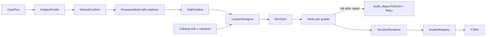

# PROJECT COGNITIVE OS (Pegazus)
## Document 10: Multi-Subject Migration Specification
**Version:** 1.2 (Phases 1–5 implemented)
**Scope:** Turn Pegazus from a math-only tutor into a tutor for **any topic the learner asks for**, without losing the math experience. This doc owns: the subject profile, the component catalog (role x category), the grader registry, the generic item/attempt schema, pipeline and frontend changes, and the phased migration.
**Supersedes:** the "algebra / math only" scope statements in [Doc 01](01-executive-summary.md), [Doc 02](02-product-requirements.md), [Doc 03](03-cognitive-engine-pedagogical.md) §evaluation, [Doc 04](04-system-architecture.md) §4.1 (SymPy as the only evaluator), [Doc 05](05-ai-orchestration-ingestion.md) (math-only prompts), [Doc 06](06-frontend-architecture-genui.md) §widget registry and [Doc 09](09-ui-ux-specification.md) §12 widget UX. Phase 5 revised them with scope notes and revision rows; where they still conflict with this doc, this doc wins.

---

### 0. Decisions (locked)

| Topic | Decision |
| :--- | :--- |
| Topic scope | **Fully open.** The AI may pick any component from one flat library. Categories organize and pre-filter; they never hard-gate. |
| Taxonomy | **Two axes:** `role` (teach / visual / answer / support) x `category` (core, math, science, language, humanities, code, media). |
| Grading | **Hybrid:** deterministic graders wherever possible, SymPy for math, test-based for code, LLM rubric judge only for open text. |
| Subject selection | AI **infers** a subject profile from the goal; the wizard shows it and the learner **confirms or edits**. |
| Static content | **Delete hardcoded math fallbacks.** On generation failure: retry with repair, then a clear error + Retry. Never fake content. |
| Existing data | **Additive** schema + backfill. Math rows keep working. Corpus stays as optional grounding. |
| Grounding | User-provided sources + AI web research **with citations**. |
| Rich capabilities (first release) | Images/diagrams, timelines/maps, runnable code (browser), audio (Web Speech TTS), flashcards, science (formulas, units, simple simulations). |
| Media generation | **Native first:** Mermaid / sanitized SVG, browser TTS. AI image generation is a later add-on. |
| Code execution | **In the browser** (Pyodide for Python, Web Worker for JS). |

---

### 1. Current math coupling (inventory)

Everything below assumes math today. Each line is a migration touchpoint.

#### 1.1 Schema
| Where | Math-specific part |
| :--- | :--- |
| `knowledge_nodes.domain` (`domain_enum`: MATHEMATICS, DEVOPS, LANGUAGE) ~~Always written as `'MATHEMATICS'`~~ — fixed in Phase 5: derived from the profile in [backend/app/pipeline/research_job.py](../backend/app/pipeline/research_job.py) (`GENERAL` added, existing rows backfilled). |
| `knowledge_nodes.canonical_equation_latex`, `expected_ast_signature` | Equation-only concepts. |
| `items.statement_latex` (NOT NULL) | Every item must be a LaTeX statement. |
| `items.steps` JSONB `{latex, sympy, operation, justification, gap_latex}` | Steps are derivation lines checked by SymPy. |
| `attempts.submitted_latex` (NOT NULL) | Every answer is a LaTeX string. |
| `supabase/seed.sql` | Algebra seed nodes/items (local tests only). |

Already generic: `learning_paths.target_goal` (free text), `plan_context`, `path_nodes.build_status` (includes `FAILED`), `lesson_beats` JSONB shape, FSRS state in `user_node_states`.

#### 1.2 Grading
- [backend/app/workers/math_evaluator.py](../backend/app/workers/math_evaluator.py) — `evaluate_step_safe`, `_evaluate`, `_parse`, `_is_solved_form`. The **only** correctness oracle.
- [backend/app/services/rule_engine.py](../backend/app/services/rule_engine.py) — `decide_verdict` maps SymPy output to math verdicts (`SIGN_ERROR`, `CALCULATION_SLIP`, `SYNTAX_ERROR`).
- [backend/app/services/jev_client.py](../backend/app/services/jev_client.py) — LLM judge, but `clamp_jev_verdict` keeps it inside the SymPy result; prompt says "read as mathematics".
- [backend/app/api_session.py](../backend/app/api_session.py) — `evaluate_step`, `final_answer_shortcut`, `_step_target`.
- Selection widgets (QuickCheck, NumberLine, MatchPairs) decide `correct` **on the client**, then `gradeFromWidget` re-submits `correct_latex` through SymPy.
- **Answer keys reach the client:** `session_genui._build_widget` sends `correctId`, `target`, aligned `pairs` and `correct_latex`, and the same `genui_plan` is embedded in `knowledge_nodes.lesson_beats` returned by `SessionNodeOut` / `PathNodeOut`. (Fixed in Phase 1, §6.4.)
- Other SymPy callers: diagnostic in [backend/app/api_paths.py](../backend/app/api_paths.py), [backend/app/services/placement_exam.py](../backend/app/services/placement_exam.py), `leak_check.py`.

#### 1.3 Prompts with math wording
| File | What is hardcoded |
| :--- | :--- |
| [backend/app/services/path_draft.py](../backend/app/services/path_draft.py) | "6 to 12 math skill modules"; `_FALLBACK_TITLES` (algebra list). |
| [backend/app/pipeline/research_brief.py](../backend/app/pipeline/research_brief.py) | "You are a math education researcher"; `problem_latex` examples. |
| [backend/app/services/lesson_beats.py](../backend/app/services/lesson_beats.py) | `_DESIGN_SYSTEM` ("ONE math skill lesson", `$...$`, KaTeX `demo_steps`); `_CRITIC_SYSTEM` (`sympy_flags`); `_fallback_beats`, `fallback_design`. |
| [backend/app/pipeline/item_gen.py](../backend/app/pipeline/item_gen.py) | `_ITEM_SHAPE` / `_SYSTEM_PROMPT` (KaTeX statement + SymPy steps); `slugify_module` prefix `math.generated`. |
| [backend/app/services/placement_exam.py](../backend/app/services/placement_exam.py) | Requires `statement_latex` + `target_sympy`; `_fallback_questions` banks of `Eq(...)`. |
| `socratic_ask.py`, `system2_hints.py`, `tutor_chat.py`, `jev_intent.py` | "math tutor", "mathematical principle", refuses non-math in `/ask`. |
| `pipeline/corpus/*`, `openstax_*`, `retriever.py` | OpenStax algebra corpus (`math.algebra.*`). Stays, as optional math grounding. |

#### 1.4 Component catalog
- [backend/app/services/component_catalog.py](../backend/app/services/component_catalog.py) — `COMPONENTS` keyed by name with `role` only; `catalog_prompt(where)`; `_SANITIZERS`.
- [backend/app/services/session_genui.py](../backend/app/services/session_genui.py) — `ALLOWED_TYPES`, `build_session_genui`, layout `algebra|calculus`, always injects SymbolicStepEditor + VirtualMathKeyboard for non-selection items.
- [frontend/lib/contracts/genui.ts](../frontend/lib/contracts/genui.ts) — Zod `AnyWidgetSchema`.
- [frontend/components/genui/registry.tsx](../frontend/components/genui/registry.tsx) — renderer switch. `tests/test_component_catalog.py` keeps backend and frontend in sync.

Of 16 components only QuickCheck, MatchPairs, Callout, ConceptCard, SocraticDialogueBox (and ValueTable) are subject-neutral.

#### 1.5 Frontend
- `components/math/MathField.tsx` (MathLive), `MathText.tsx` (KaTeX), `VirtualMathKeyboard`, `SymbolicStepEditor`.
- [frontend/app/[locale]/session/page.tsx](../frontend/app/[locale]/session/page.tsx) — `submitStep` / `gradeFromWidget` send `submitted_latex`; `ProblemStatement` takes `statementLatex`.
- [frontend/app/[locale]/path/new/page.tsx](../frontend/app/[locale]/path/new/page.tsx) — free-text goal (good) but placeholder "Master linear equations…"; placement step uses MathField.

---

### 2. Target architecture



The lesson model (beats: teach + problem, FSRS per node, scaffold levels) does not change. What changes is **what fills a beat** (catalog), **how an answer is judged** (grader), and **what context every prompt gets** (subject profile).

---

### 3. Subject profile

One JSON object per path, inferred by one LLM call at ingest, shown in the wizard for confirmation, stored on `learning_paths.subject_profile` and copied onto each `knowledge_nodes.subject_profile` (nodes may later diverge, e.g. a "math for chemistry" node).

```json
{
  "subject": "Spanish A2 travel vocabulary",
  "family_hint": "language",
  "categories": ["core", "language", "media"],
  "notation": "none",
  "code_language": null,
  "target_language": "es",
  "instruction_language": "en",
  "answer_modes": ["choice", "cloze", "short_text", "speech"],
  "level": "beginner"
}
```

| Field | Type / allowed values | Use |
| :--- | :--- | :--- |
| `subject` | string ≤ 120 | Human label; injected in every prompt. |
| `family_hint` | free string | Display only ("Language", "History"…). Not an enum: topics are open. |
| `categories` | subset of `core, math, science, language, humanities, code, media`; `core` always present | Pre-filters `catalog_prompt()`; the designer may still request any component (logged as `off_profile`). |
| `notation` | `none | math | chem | code` | Picks renderers/inputs: KaTeX + MathLive (math), KaTeX mhchem (chem), code editor (code), plain text (none). |
| `code_language` | `python | javascript | null` | Selects the browser runner. |
| `target_language` / `instruction_language` | BCP-47 | TTS voice and lesson language; `instruction_language` defaults to app locale. |
| `answer_modes` | subset of grader-friendly modes | Steers item_gen toward allowed answer components. |
| `level` | `beginner | intermediate | advanced` | Prompt tuning only. |

**Validation (trust boundary):** the server clamps every field (unknown categories dropped, strings truncated, `core` forced). The wizard edit goes through the same validator. Inference also returns `allowed: bool` + `reason` (R6).

**Wizard UX:** after the goal step, a "We think this is…" card shows `subject`, category chips (toggleable) and notation (segmented control). One click to accept.

**API:** `POST /ingest` starts research immediately, so inference is a separate pre-ingest call: `POST /api/v1/paths/profile` returns the clamped profile; `PathIngestIn` gains an optional `subject_profile` (clamped again; inferred when absent).

**Existing rows** (backfill, §6.3): `{"subject": <target_goal or title, ≤120>, "categories": ["core","math"], "notation": "math"}`.

---

### 4. Component catalog (role x category)

#### 4.1 Entry shape

```python
COMPONENTS["Cloze"] = {
    "role": "answer",               # teach | visual | answer | support
    "category": "core",             # core | math | science | language | humanities | code | media
    "where": ("problem",),          # teach and/or problem beats
    "when": "fill missing words/terms in a sentence or definition",
    "props": '{"text":"The capital of France is [[Paris]].","aliases":{"0":["paris"]}}',
    "grader": "cloze",              # answer role only
    "lazy": False,                  # frontend loads the pack on demand
}
```

`catalog_prompt(where, categories=None)` lists components whose `where` matches and whose `category` is in the profile (plus `core`); `None` lists all (current callers). The same `COMPONENTS` dict derives the backend whitelists (`WORKSPACE_WIDGETS`, `SELECTION_PRIMARY` = answer components whose grader is not `sympy`). Every visual/answer component has a **sanitizer** (bounded, checked props) like today's `_SANITIZERS`; an invalid payload renders the beat as text, never a broken widget. `tests/test_component_catalog.py` asserts that backend names, frontend registry cases and Zod schemas match, and that every `answer` entry has a registered grader.

#### 4.2 Catalog

Legend: **T** teach, **P** problem. Grader only for `answer` role. "Props example" for answer components shows what the generator writes; the key part (e.g. `correctIds`, `pairs`, `value`) is split into `answer_spec` at write time and never sent to the client (§6.2).

**core** (any subject)

| Component | Role | Where | Grader | Props example | Sanitizer notes |
| :--- | :--- | :--- | :--- | :--- | :--- |
| ConceptCard | support | T | — | auto: teach body | md ≤ 2k chars |
| Callout | visual | T | — | `{"tone":"tip","title":"…","body_md":"…"}` | existing |
| DataTable (was ValueTable) | visual | T, P | — | `{"headers":["Verb","yo"],"rows":[["ser","soy"]],"highlight_col":1}` | ≤ 6 cols, ≤ 12 rows |
| Comparison | visual | T | — | `{"left":{"title":"Mitosis","points":["2 cells"]},"right":{"title":"Meiosis","points":["4 cells"]}}` | 2 columns, ≤ 6 points each |
| ProcessSteps | visual | T, P | — | `{"steps":[{"title":"Evaporation","body":"…"}],"cyclic":true}` | 2–8 steps |
| KeyTerms | visual | T | — | `{"terms":[{"term":"Photosynthesis","def":"…"}]}` | ≤ 8 terms |
| WorkedExample (generalizes FadedWorkedExample) | answer | P | per step: `sympy` / `exact` | `{"steps":[{"text":"…","blank":true}]}` | 2–8 steps; blank count ≥ 1 |
| QuickCheck | answer | P | `choice` | props `{"prompt":"…","choices":[{"id":"a","label":"…"}],"labelsAreLatex":false,"multi":false}`; spec `{"correctIds":["a"],"explanation":"…"}` | 2–6 choices; correct ⊂ choices; true/false = 2 choices; `explanation` returned as `feedback` on success |
| MatchPairs | answer | P | `match` | props `{"lefts":["perro","gato"],"rights":["cat","dog"]}` (rights pre-shuffled); spec `{"pairs":[[0,1],[1,0]]}` | 2–6 pairs, unique sides |
| OrderSteps | answer | P | `order` | `{"items":["Treaty of Versailles","WWII starts"],"prompt":"Oldest first"}` | 3–7 items; stored order is the answer |
| Categorize | answer | P | `categorize` | `{"buckets":["Metal","Non-metal"],"items":[{"label":"Fe","bucket":0}]}` | 2–4 buckets, 4–10 items |
| Cloze | answer | P | `cloze` | `{"text":"Water boils at [[100]] °C.","aliases":{"0":["100°C"]}}` | 1–4 blanks |
| ShortAnswer | answer | P | `exact` (fallback `rubric_llm`) | `{"question":"…","accepted":["Paris"],"rubric":null}` | `accepted` ≤ 10 |
| FreeResponse | answer | P | `rubric_llm` | `{"question":"Explain why…","rubric":[{"criterion":"mentions supply","points":1}],"max_words":150}` | 1–5 criteria |
| SocraticDialogueBox | support | P | — | auto hints | existing |
| TutorChat | support | P | — | session sheet | existing |

**math** (`notation: math`)

| Component | Role | Where | Grader | Notes |
| :--- | :--- | :--- | :--- | :--- |
| SymbolicStepEditor | answer | P | `sympy` | Keeps final-answer shortcut, chips, reveal. |
| NumberLine | answer | P | `numeric` | Props `{min,max,step,prompt}`; server-graded from `answer_spec {value, abs_tolerance}` (no client `correct`). |
| FunctionPlotter | visual | T, P | — | existing sanitizer |
| FractionBars | visual | T, P | — | existing (label must match picture) |
| BalanceScale | visual | T, P | — | existing (sides must parse) |
| ShapeDiagram | visual | T, P | — | existing (angles sum check) |
| CoordinateGrid | visual | T, P | — | existing |
| VirtualMathKeyboard | support | P | — | auto with math answers |

**science**

| Component | Role | Where | Grader | Props example | Sanitizer notes |
| :--- | :--- | :--- | :--- | :--- | :--- |
| ChemFormula | visual | T, P | — | `{"latex":"\\ce{2H2 + O2 -> 2H2O}","caption":"…"}` | must render in KaTeX mhchem |
| QuantityAnswer | answer | P | `numeric` | `{"question":"…","value":9.8,"unit":"m/s^2","tolerance":0.05}` | unit parsed by a small unit table; tolerance 0–0.2 |
| ParameterExplorer | visual | T | — | `{"expr":"v0*t - 4.9*t^2","params":[{"name":"v0","min":0,"max":30}],"x":"t","domain":[0,6]}` | expr must parse (SymPy), ≤ 3 params |
| LabeledDiagram | visual | T, P | — | `{"svg_ref":"mermaid|svg","labels":[{"x":0.4,"y":0.2,"text":"Nucleus"}]}` | coords 0–1, ≤ 12 labels; SVG sanitized |

**language**

| Component | Role | Where | Grader | Props example | Sanitizer notes |
| :--- | :--- | :--- | :--- | :--- | :--- |
| Flashcards | answer | T, P | `exact` (self-rate optional) | `{"cards":[{"front":"el aeropuerto","back":"the airport","audio":true}]}` | 3–12 cards |
| Pronunciation | answer | P | `speech_match` (optional) / self-rate | `{"phrase":"¿Dónde está el baño?","lang":"es-ES"}` | lang must be BCP-47; graceful when SpeechRecognition missing |
| TranslationAnswer | answer | P | `exact` then `rubric_llm` | `{"source":"Where is the station?","accepted":["¿Dónde está la estación?"],"lang":"es"}` | ≤ 10 accepted |

**humanities**

| Component | Role | Where | Grader | Props example | Sanitizer notes |
| :--- | :--- | :--- | :--- | :--- | :--- |
| Timeline | visual | T, P | — | `{"events":[{"date":"1789-07-14","label":"Storming of the Bastille"}]}` | 2–12 events; dates parse (year or ISO; BCE as negative year) |
| MapPins | visual | T, P | — | `{"region":"europe","pins":[{"lat":48.85,"lon":2.35,"label":"Paris"}]}` | lat/lon ranges; ≤ 12 pins; region from a fixed list |
| SourceExcerpt | visual | T | — | `{"quote":"…","author":"…","source":"…","url":"…","year":1791}` | quote ≤ 600 chars; `url` must be from research citations |
| CauseEffect | visual | T | — | `{"links":[{"cause":"…","effect":"…"}]}` | 1–6 links |

**code** (`notation: code`)

| Component | Role | Where | Grader | Props example | Sanitizer notes |
| :--- | :--- | :--- | :--- | :--- | :--- |
| CodeBlock | visual | T, P | — | `{"language":"python","code":"for i in range(3):\n    print(i)"}` | ≤ 60 lines |
| CodeExercise | answer | P | `code_tests` | `{"language":"python","starter":"def add(a,b):\n    ...","tests":[{"call":"add(2,3)","expect":"5"}]}` | 1–8 tests; reference solution must pass at generation |
| PredictOutput | answer | P | `exact` | `{"language":"python","code":"print(2**3)","accepted":["8"]}` | output ≤ 200 chars |

**media**

| Component | Role | Where | Grader | Props example | Sanitizer notes |
| :--- | :--- | :--- | :--- | :--- | :--- |
| Diagram | visual | T, P | — | `{"kind":"mermaid","source":"flowchart LR; A-->B","alt":"…"}` | Mermaid parsed in a worker, `securityLevel: strict`; SVG via DOMPurify; `alt` required |
| AudioClip | visual | T, P | — | `{"text":"Bonjour","lang":"fr-FR","rate":0.9}` | Web Speech TTS; hidden if no voice for `lang` |

Rule kept from today: one primary answer component per problem beat, ≤ 4 widgets per beat (`MAX_WIDGETS`), layouts `stack | split | focus`.

---

### 5. Grader registry

Replaces the SymPy-only path. One module per grader under `backend/app/graders/`, one registry dict:

```python
GRADERS: dict[str, Callable[[dict, Any], GradeResult]] = {
    "choice": grade_choice, "match": grade_match, "order": grade_order,
    "categorize": grade_categorize, "exact": grade_exact, "cloze": grade_cloze,
    "numeric": grade_numeric, "sympy": grade_sympy, "code_tests": grade_code_tests,
    "speech_match": grade_speech_match, "rubric_llm": grade_rubric_llm,
}

@dataclass
class GradeResult:
    verdict: str            # CORRECT_OPTIMAL | PARTIAL | INCORRECT | SIGN_ERROR | SYNTAX_ERROR | ...
    is_success: bool
    score: float            # 0..1 (partial credit for match/order/cloze/categorize/rubric)
    feedback: str | None    # short, learner-facing
    decided_by: str         # RULES | JEV | CLIENT
    extra: dict             # sympy: {"eval_result": …} so evaluate_step can still feed JEV
```

Success keeps today's verdict string `CORRECT_OPTIMAL` (frontend banners and `jev_is_success` key on it); `PARTIAL` (0 < score < 1) and `INCORRECT` (score 0) are new constants in `rule_engine.py`. `grade(grader, spec, answer)` never raises: unknown grader, malformed spec or answer → `SYNTAX_ERROR`.

| Grader | Input (`answer`) | Spec (`answer_spec`) | Logic |
| :--- | :--- | :--- | :--- |
| `choice` | `{"ids":["a"]}` | `{"correctIds":["a"],"explanation":"…"}` | set equality |
| `match` | `{"pairs":[[0,2],…]}` (left index, right index as displayed) | `{"pairs":[[0,2],…]}` | one-to-one required (else `SYNTAX_ERROR`); score = fraction |
| `order` | `{"order":[2,0,1]}` | `{"order":[…]}` canonical order | exact; score = Kendall-tau normalized |
| `categorize` | `{"assign":{"0":1}}` | `{"assign":[1,0,…]}` bucket per item | score = fraction correct; success only at 1.0 |
| `exact` | `{"text":"Paris"}` | `{"accepted":[…],"case":false,"strip_accents":false}` | NFKC, trim, casefold, strip accents optional, punctuation-insensitive |
| `cloze` | `{"blanks":["100"]}` | `{"answers":[["100","100°C"]]}` | `exact` per blank; partial score |
| `numeric` | `{"value":9.81,"unit":"m/s^2"}` | `{"value":9.8,"unit":"m/s^2","tolerance":0.05}` or `{"value":5,"abs_tolerance":0.5}` | unit-convert then relative `tolerance` (clamped 0–0.2) or absolute `abs_tolerance`; bare number = spec unit; other dimension = incorrect |
| `sympy` | `{"latex":"x=5"}` | `{latex, sympy, operation}` per step | current `evaluate_step_safe` + `final_answer_shortcut` |
| `code_tests` | `{"passed":3,"total":3,"code":"…"}` | tests | trust client result (see risk R2); store code |
| `speech_match` | `{"transcript":"…"}` | phrase | normalized `exact` with edit-distance tolerance; else self-rate |
| `rubric_llm` | `{"text":"…"}` | `{"rubric":[…],"exemplar":"…"}` | LLM scores each criterion → score; deterministic pre-check (empty / too short / copied prompt) first |

**Rules:**
- The client never sends `correct: true`. Deterministic graders run **server-side** from `answer_spec`; the client only sends what the learner did.
- `rubric_llm` uses the learner's BYO key or the server key, with a per-session cost cap (reuses `add_session_cost`). No key → it falls back to `exact` against an exemplar's key terms and marks the attempt `decided_by=RULES`.
- JEV (`jev_client`) becomes the `rubric_llm` engine and keeps the clamp only for `sympy`; deterministic graders never call it.
- Inputs are bounded at the trust boundary: ≤ 20 ids/pairs/items/blanks, text ≤ 500 chars, whole `answer` ≤ 4 KB JSON.
- Verdict → FSRS grade mapping stays in `rule_engine._fsrs_grade(success, hint_level, latency_ms, score=1.0)`; `0 < score < 1` (`PARTIAL`) → FSRS 2 "Hard"; score 0 → 1 "Again". FSRS is applied on the item's final part.

---

### 6. Generic item and attempt schema (additive migration)

#### 6.1 Migration `20261009180000_multi_subject.sql`

```sql
ALTER TABLE public.learning_paths  ADD COLUMN IF NOT EXISTS subject_profile JSONB;
ALTER TABLE public.knowledge_nodes ADD COLUMN IF NOT EXISTS subject_profile JSONB;

ALTER TABLE public.items
  ADD COLUMN IF NOT EXISTS prompt_md      TEXT,
  ADD COLUMN IF NOT EXISTS stimulus       JSONB,          -- visual widgets shown with the item
  ADD COLUMN IF NOT EXISTS answer_spec    JSONB,          -- grader-specific spec (never sent raw to client)
  ADD COLUMN IF NOT EXISTS grader         TEXT,
  ADD COLUMN IF NOT EXISTS parts          JSONB,          -- multi-part items (generalizes steps)
  ADD COLUMN IF NOT EXISTS explanation_md TEXT;
ALTER TABLE public.items ALTER COLUMN statement_latex DROP NOT NULL;

ALTER TABLE public.attempts
  ADD COLUMN IF NOT EXISTS submitted_answer JSONB,
  ADD COLUMN IF NOT EXISTS grader           TEXT,
  ADD COLUMN IF NOT EXISTS score            REAL;
ALTER TABLE public.attempts ALTER COLUMN submitted_latex DROP NOT NULL;
```

`domain_enum` stays for back-compat; new code reads `subject_profile`. `attempts.step_index` (NOT NULL) stores `part_index` (same meaning; no new column). `items.grader` is the item's primary grader (= `parts[0].grader`); grading reads the per-part `parts[].grader` / `parts[].answer_spec`, so the item-level `answer_spec` column is reserved and unused in Phase 1. `path_nodes.build_error` already exists (`20261009120000_lesson_pipeline.sql`).

#### 6.2 Item shape (new rows)

```json
{
  "prompt_md": "Put these events in order, oldest first.",
  "stimulus": [{"type": "Timeline", "props": {"events": []}}],
  "parts": [
    {"component": "OrderSteps", "grader": "order",
     "props": {"items": ["WWII starts", "Treaty of Versailles"]},
     "answer_spec": {"order": [1, 0]},
     "justification": "Versailles (1919) came before 1939"}
  ],
  "explanation_md": "…"
}
```

A math item is the same shape with `grader: "sympy"` parts (one per derivation step). `answer_spec` is stripped from every API response; the client gets only `{component, grader, props}`.

**Exception — math `steps` stay client-visible** (`SessionItemOut.steps` feeds Reveal step and gap prefill). `ponytail:` low-stakes practice; upgrade path = a server `reveal` endpoint. Non-sympy items send `steps: []`.

#### 6.3 Backfill (same migration)
Every `UPDATE … WHERE <col> IS NULL`, so the file is re-runnable. `backend/app/graders/legacy.py::legacy_parts` is its Python twin (used for new items and NULL rows); `tests/test_multi_subject_backfill.py` asserts both produce the same parts.
- `items.grader = 'sympy'`, `items.parts` = one part per existing step (`component: SymbolicStepEditor`, `answer_spec: {latex, sympy, operation}`, `justification`), `prompt_md = prompt`.
- Selection-primary items: `distractors`/`pairs` are not columns; the source is the first `genui_plan.widgets[]` entry whose `type = genui_plan.primary` (QuickCheck / MatchPairs / NumberLine). One part, key fields moved from `props` into `answer_spec`:
  - QuickCheck → `choice`, `{correctIds:[correctId], explanation}`; only if `correctId` is one of `choices`.
  - NumberLine → `numeric`, `{value: target, abs_tolerance: tolerance ?? step/2}`; only if `target` is a number.
  - MatchPairs → `match`; props `lefts` (stored order) + `rights` shuffled deterministically by `md5(item_id:i)`; `answer_spec.pairs` maps each left to its shuffled right. Needs ≥ 2 pairs.
  - Invalid key data → the item keeps its `sympy` parts.
- `learning_paths.subject_profile` / `knowledge_nodes.subject_profile` = `{"subject": <goal>, "categories": ["core","math"], "notation": "math"}` (node: earliest path's goal, else node title).
- `attempts.grader = 'sympy'`, `submitted_answer = {"latex": submitted_latex}`.

#### 6.4 API contract
- `POST /api/v1/session/evaluate-step` body becomes `{item_id, part_index, answer, session_id, hint_level, scaffold_level, latency_ms}`. Until the legacy-removal ticket (Doc 11 MS-5.3) it still accepts `step_index` + `submitted_latex` and maps them to `{part_index, answer: {latex}}`; neither given → 422; `answer` > 4 KB → 422.
- Response adds `score`, `feedback`, `grader`; keeps `verdict`, `is_success`, `is_final_step`, `genui`.
- Offline sync (`syncOfflineAttempts`) sends and stores `{part_index, answer}`; queued legacy records are mapped on read. Same grading code as evaluate-step (including `final_answer_shortcut`).
- Session item payload: `prompt_md`, `stimulus`, `parts[].{component, grader, props}` (no `answer_spec`).
- **No key leaves the server:** session GenUI selection widgets carry only public props; `lesson_beats[].genui_plan.widgets` are reduced to widget names in `SessionNodeOut` and `PathNodeOut`. Selection widgets are only rendered for selection items (a sympy item cannot grade them). `tests/test_answer_leak.py` guards this.

---

### 7. Pipeline changes

| Stage | Change |
| :--- | :--- |
| Ingest | New `infer_subject_profile(goal, exam_text, sources)` — one LLM call, validated, exposed as `POST /api/v1/paths/profile` (§3); ingest stores the confirmed profile. |
| Research brief | Prompt becomes "You are an education researcher for {subject}". For non-math profiles, runs web research; the existing brief `sources` entries gain `quote`, and only URLs returned as `url_citations` are citable; corpus retriever only when `"math" in categories` or user enabled it. |
| Path outline (`propose_outline`) | "6 to 12 skill modules for {subject} at {level}". `_FALLBACK_TITLES` and `_heuristic_titles` deleted. |
| Lesson design (`_DESIGN_SYSTEM`) | Subject + notation injected; `catalog_prompt(where, categories)`; KaTeX instructions only when `notation in (math, chem)`. `_fallback_beats`, `fallback_design`, `build_lesson_beats`, `_demo_from_statement`, `_default_plan` deleted when unreferenced. |
| Item gen | Prompt asks for the §6.2 shape; `answer_modes` steers the answer components. `slugify_module` prefix becomes the subject slug. Math items keep today's shape and get `parts` via `legacy_parts`. |
| Placement exam | Same §6.2 shape (choice/short/numeric parts); keys travel HMAC-signed, not in props. `_fallback_questions` and `_pick_bank` deleted. |
| Tutor / hints / `/ask` | "Socratic tutor for {subject}"; `/ask` no longer refuses non-math, it scopes to the learner's question. |

#### 7.1 Verification per grader (before an item is `VERIFIED`)
| Grader | Check |
| :--- | :--- |
| `sympy` | today's SymPy verify-and-repair loop |
| `choice` / `match` / `order` / `categorize` / `cloze` | structural consistency (answer ⊂ options, unique labels, every blank has ≥ 1 answer) + critic LLM checks the key is actually correct |
| `numeric` | units parse; value finite; critic recomputes |
| `code_tests` | reference solution passes its tests in the browser runner on first prepare; until then the item is `VERIFIED` with `answer_spec.beta = true` and served with a "beta" chip (`UNVERIFIED` is not in `item_status_enum`; see R2) |
| `rubric_llm` | rubric has ≥ 1 criterion; exemplar scores ≥ 0.8 against its own rubric |

Batched verify-and-repair (existing) stays: failing items get one repair round.

#### 7.2 Failure policy (no static fallbacks)
- Each stage retries once with a repair prompt that includes the validator error.
- On final failure: `path_nodes.build_status = 'FAILED'` + `build_error` (short, learner-safe reason; raw exception only in logs). No placeholder lesson, no seed items.
- UI: path detail and session prepare show an EmptyState with the reason and a **Retry** button (calls existing rematerialize).

---

### 8. Frontend changes

- **Registry by category:** `components/genui/<category>/*`. Heavy packs load lazily with `next/dynamic`: code (CodeMirror + Pyodide worker), humanities map (SVG map data), media (Mermaid worker). Core stays in the main bundle.
- **Contracts:** one Zod schema per new component in `lib/contracts/genui.ts`, generated list checked by the catalog sync test.
- **Answer bar:** the session page dispatches on `part.grader`: text input for `exact`/`rubric_llm`, MathField only when `notation=math`, code editor for `code_tests`, widget-owned submit for selection graders. Submit sends `{part_index, answer}`.
- **Feedback:** verdict banner shows `feedback` when present and a score ring for partial credit.
- **Statement rendering:** `ProblemStatement` renders `prompt_md` through Markdown + KaTeX (`$…$` only when notation is math/chem).
- **Wizard:** goal placeholder becomes topic-neutral ("e.g. Order food in Spanish, Python loops, the French Revolution"); new profile-confirm step (§3).
- **Accessibility:** every new visual has `alt`/text equivalent; drag-and-drop components (OrderSteps, Categorize) have a keyboard mode (select + move buttons); TTS controls are buttons with labels; respect `prefers-reduced-motion`.
- **i18n:** all new chrome strings in `messages/en.json` and `es.json`; lesson content language follows `instruction_language`.

---

### 9. Phased migration

| Phase | Scope | Exit criteria | Checks |
| :--- | :--- | :--- | :--- |
| **1. Catalog + graders** | Two-axis `COMPONENTS`; `backend/app/graders/` registry with `choice, match, order, categorize, exact, cloze, numeric, sympy`; §6 migration + backfill; `evaluate-step` accepts `answer` (legacy fields still work); selection widgets graded server-side. | Existing math paths play end-to-end with no visible change. | Catalog sync test; one test file per grader; backfill test on seed data; existing session tests green. |
| **2. Subject profile + prompts** | `infer_subject_profile`; wizard confirm step; all prompts parameterized; delete `_FALLBACK_TITLES`, `_fallback_beats`, `fallback_design`, `_fallback_questions`; `FAILED` + Retry UX. | A non-math goal produces an outline and a lesson of core components (or a clean FAILED with Retry). | Profile validator test; prompt snapshot test (no "math" when `notation=none`); failure-path test. |
| **3. Core generic components** | ShortAnswer, FreeResponse (`rubric_llm`), Cloze, OrderSteps, Categorize, Flashcards, DataTable, Comparison, ProcessSteps, KeyTerms, Diagram. | Smoke path "Photosynthesis basics" plays with no math widgets. | Sanitizer tests; axe smoke on each component; rubric grader test with mocked LLM. |
| **4. Family packs** | humanities (Timeline, MapPins, SourceExcerpt, CauseEffect); language (Pronunciation, TranslationAnswer, AudioClip); science (ChemFormula, QuantityAnswer, ParameterExplorer, LabeledDiagram); code (CodeBlock, CodeExercise, PredictOutput). | Smoke paths pass: "Spanish travel vocabulary", "French Revolution", "Stoichiometry", "Python loops". | One sanitizer test per component; Pyodide runner test (reference solution passes); bundle check: core route JS does not grow by more than 15 KB gz. |
| **5. Research + docs** | Web research with citations for non-math; SourceExcerpt URLs restricted to citations; revise Docs 01–09 to multi-subject scope. | Every non-math lesson shows its sources. | Citation leak test (no uncited URL rendered). |

Each phase is shippable on its own; math never regresses.

---

### 10. Open risks

| ID | Risk | Mitigation |
| :--- | :--- | :--- |
| R1 | `rubric_llm` cost and inconsistency | Per-session cost cap; rubric + exemplar in `answer_spec`; deterministic pre-checks; temperature 0; cache by (item, normalized answer). |
| R2 | `code_tests` results are client-trusted (low-stakes learning) | Store submitted code with the attempt; upgrade path: re-run in a server sandbox (Vercel / Cloudflare Sandbox) before it counts toward FSRS mastery. |
| R3 | Map data and code runtimes inflate bundles | Lazy packs per category; Pyodide loaded from CDN only on first CodeExercise; simplified regional SVG maps. |
| R4 | Web research quality, hallucinated citations | Only URLs actually fetched are citable; critic LLM checks claims against fetched quotes; user sources ranked first. |
| R5 | Pronunciation scoring limited without paid speech-to-text | Web Speech recognition where available, otherwise self-rate; never block progress on speech. |
| R6 | Open topics include unsafe or non-educational requests | Profile inference also returns `allowed: bool` + reason; refused goals get a clear message; minors' consent rules unchanged. |
| R7 | Off-profile components chosen by the designer | Allowed (open scope) but logged; sanitizer still applies; analytics review after Phase 3. |

---

### 11. Revision history

| Version | Date | Change |
| :--- | :--- | :--- |
| 1.0 | 2026-10-09 | Initial multi-subject migration spec (planning). |
| 1.2 | 2026-10-09 | All phases implemented. Phase 5 decisions: `knowledge_nodes.domain` derived from the profile (math → MATHEMATICS, language → LANGUAGE, else new `GENERAL`), backfilled (§1.1); non-math research always uses the web plugin (retry once, then non-web fallback) and stores citation `quote`s; lesson/path payloads expose `sources [{title,url}]` and scrub every other URL at read time (links keep their text) and item text at write time (§7); critic checks claims against source quotes; legacy evaluate fields removed from the API, while the client still converts old queued offline records (§6.1). Docs 01–09 revised (Phase 5 note in the header is now done). |
| 1.1 | 2026-10-09 | Aligned with Doc 11 "Spec decisions" and the Phase 1 build: answer-key leak inventoried and closed (§1.2, §6.4); math `steps` stay client-visible (§6.2); success verdict stays `CORRECT_OPTIMAL`, plus `PARTIAL`/`INCORRECT` (§5); `part_index` stored in `attempts.step_index`, per-part grader/spec (§6.1); backfill source = `genui_plan` widget props with exact shapes (§6.3); QuickCheck keeps `prompt/choices/labelsAreLatex` + `multi`, MatchPairs `lefts/rights` (§4.2); concrete grader spec shapes incl. `abs_tolerance` (§5); PARTIAL → FSRS Hard and input bounds (§5); pre-ingest profile endpoint (§3); code items `VERIFIED` + `beta` instead of `UNVERIFIED` (§7.1); citations extend brief `sources` (§7); full fallback delete list (§7). |
