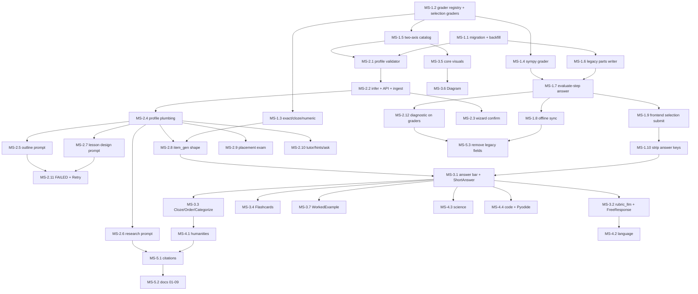

# PROJECT COGNITIVE OS (Pegazus)
## Document 11: Multi-Subject Execution Plan
**Version:** 1.1
**Date:** 2026-10-09
**Status:** all tickets MS-1.1 … MS-5.3 done (Phase 5 status notes in §8).
**Source:** [Doc 10: Multi-Subject Migration Specification](10-multi-subject-spec.md) (this doc never overrides it; where it had to decide something Doc 10 left open, it says so under "Spec decisions").

### How to use
- **One ticket = one PR.** Pick the lowest-numbered ticket whose `Depends on` are all merged.
- Tickets are ordered; IDs are `MS-<phase>.<n>`. Phases match Doc 10 §9 and each phase is shippable on its own.
- Every ticket lists: Goal, Files, Steps, Acceptance, Checks, Depends on, Size (S ≤ ½ day, M ≤ 2 days, L > 2 days).
- Paths are repo-relative. Backend test paths are relative to `backend/` (the container mounts it at `/app`).

---

### 1. Guiding rules
1. **Math never regresses.** Every ticket runs the math guard, even frontend-only ones that touch the session:
   ```
   docker compose exec -T api python -m pytest -q tests/test_math_evaluator.py tests/test_final_answer_shortcut.py tests/test_session_genui.py tests/test_session_item_prompt.py tests/test_component_catalog.py tests/test_lesson_beats.py tests/test_item_gen.py
   ```
   Never run the whole suite (one test hangs). Frontend tickets also run, in `frontend/`: `npx tsc --noEmit`, `npx eslint .`, `npm run axe:smoke`.
2. **Additive DB only.** New columns are nullable; no drops/renames. `domain_enum`, `statement_latex`, `steps`, `submitted_latex` stay.
3. **Legacy `evaluate-step` fields** (`step_index`, `submitted_latex`) and legacy offline-queue records keep working until **MS-5.3** removes them. *(Removed from the API in MS-5.3; the client still converts old queued records.)*
4. **Lazy, minimal code** (project rule): simplest thing that works, no new abstractions beyond the grader registry Doc 10 asks for, `ponytail:` comment on every known shortcut naming its ceiling and upgrade path, one small runnable test per non-trivial logic (plain pytest asserts, no fixtures frameworks).
5. **Never trust client correctness.** The client sends what the learner did; the server grades from `answer_spec`. Only exception: `code_tests` (Doc 10 R2), marked `decided_by='CLIENT'`.
6. **i18n:** every new UI string in both `frontend/messages/en.json` and `es.json` (namespaces `pathNew`, `pathDetail`, `session`, …).
7. **Accessibility:** keyboard path for every interactive component; `alt`/text equivalent for every visual. Because `npm run axe:smoke` checks the static `frontend/scripts/axe-fixture.html`, each new component adds its rendered markup to that fixture.

### 2. Spec decisions made while grounding (read before starting)
- **Answer keys already reach the client today.** `session_genui._build_widget` sends `correctId` (QuickCheck), `target` (NumberLine), aligned `pairs` (MatchPairs) and `correct_latex`; the same `genui_plan` is embedded in `knowledge_nodes.lesson_beats` returned by `SessionNodeOut.lesson_beats` and `PathNodeOut.lesson_beats`. MS-1.10 strips all of them.
- **Math `steps` stay client-visible** (`SessionItemOut.steps` feeds Reveal step and gap prefill). `ponytail:` low-stakes practice; upgrade path = a server `reveal` endpoint.
- **Verdict strings:** success stays `CORRECT_OPTIMAL` (frontend banners and `jev_is_success` key on it); new graders add `PARTIAL` and `INCORRECT` constants in `rule_engine.py`.
- **`part_index` is stored in `attempts.step_index`** (NOT NULL, same meaning); no new column.
- **Backfill source:** `distractors`/`pairs` are not columns; selection data lives in `items.genui_plan.widgets[0].props`.
- **`UNVERIFIED` is not in `item_status_enum`**; code items stay `VERIFIED` with `answer_spec.beta = true` (MS-4.4).
- **Profile confirmation needs a pre-ingest call**: `POST /ingest` starts research immediately, so inference is a separate endpoint and `PathIngestIn` gains `subject_profile`.
- **Prop names:** keep current QuickCheck props (`prompt`, `choices`, `labelsAreLatex`) on the wire; add `multi`. Doc 10's `question/options` names are not adopted (rename churn, no benefit).

---

### 3. Dependency graph



---

### 4. Phase 1: Catalog + graders
Exit: existing math paths play end-to-end with no visible change (except that wrong selection answers are now recorded server-side).

#### MS-1.1 Migration `multi_subject.sql` + backfill
- **Goal:** Add Doc 10 §6.1 columns and backfill existing rows so every item has `parts`/`grader`.
- **Files:** new `supabase/migrations/20261009180000_multi_subject.sql`; new `backend/tests/test_multi_subject_backfill.py`.
- **Steps:**
  - Copy §6.1 DDL verbatim (all `IF NOT EXISTS`, `DROP NOT NULL` on `items.statement_latex`, `attempts.submitted_latex`).
  - Backfill, each `UPDATE … WHERE <col> IS NULL` so the file is re-runnable:
    - `items.prompt_md = prompt`; `grader = 'sympy'`; `parts` = one `{component:"SymbolicStepEditor", grader:"sympy", props:{}, answer_spec:{latex,sympy,operation}, justification}` per element of `steps` (`jsonb_array_elements … WITH ORDINALITY`, re-aggregated in order).
    - Selection-primary items (`genui_plan->>'primary' IN ('QuickCheck','MatchPairs','NumberLine')`): overwrite `parts` with one part: QuickCheck → `grader:'choice'`, `answer_spec:{correctIds:[props.correctId], explanation}`; MatchPairs → `grader:'match'`, props `lefts` + `rights` shuffled by `md5(item_id:i)`, `answer_spec:{pairs:[[left, shuffled right]…]}`; NumberLine → `grader:'numeric'`, `answer_spec:{value:props.target, abs_tolerance:props.tolerance ?? step/2}` (NumberLine tolerance is absolute). Keep `props` minus the key fields; invalid key data keeps the sympy parts.
    - `learning_paths/knowledge_nodes.subject_profile = {"subject": target_goal|title, "categories":["core","math"], "notation":"math"}` (`jsonb_build_object`).
    - `attempts.grader='sympy'`, `submitted_answer = {"latex": submitted_latex}`.
- **Acceptance:** `supabase db reset` applies cleanly; re-running the file is a no-op; seed math items have one part per step.
- **Checks:** `supabase db reset`; `docker compose exec -T api python -m pytest -q tests/test_multi_subject_backfill.py` — the test connects to `settings.database_url` (skips if unreachable), opens a transaction, inserts one multi-step item, one QuickCheck-plan item, one NumberLine-plan item and one attempt, executes `/supabase/migrations/20261009180000_multi_subject.sql`, asserts parts/graders/answer_specs, then rolls back.
- **Depends on:** — **Size:** M

#### MS-1.2 Grader registry + selection graders
- **Goal:** `backend/app/graders/` with `GradeResult`, `GRADERS` and `choice`, `match`, `order`, `categorize`.
- **Files:** new `backend/app/graders/__init__.py` (`GradeResult` dataclass per §5, `GRADERS` dict, `grade(grader, spec, answer) -> GradeResult` that returns `SYNTAX_ERROR` for unknown grader/malformed answer), `choice.py`, `match.py`, `order.py`, `categorize.py`; `backend/app/services/rule_engine.py` (add `VERDICT_PARTIAL`, `VERDICT_INCORRECT`; `_fsrs_grade(success, hint_level, latency_ms, score=1.0)` → returns 2 when `0 < score < 1`).
- **Steps:** one function per module, pure, no I/O; bound input sizes (≤ 20 ids/pairs/items) and reject non-int indices; `order` score = normalized Kendall tau (pairwise inversions, O(n²), n ≤ 7, `ponytail:` comment); `categorize`/`match` score = fraction correct, success only at 1.0.
- **Acceptance:** `grade("choice", {"correctIds":["a"]}, {"ids":["a"]}).is_success`; garbage answers never raise.
- **Checks:** new `tests/graders/test_choice.py`, `test_match.py`, `test_order.py`, `test_categorize.py` (+ `tests/graders/__init__.py`); math guard.
- **Depends on:** — **Size:** M

#### MS-1.3 Text and numeric graders: `exact`, `cloze`, `numeric`
- **Goal:** Deterministic text/number grading per §5.
- **Files:** `backend/app/graders/exact.py` (`normalize(s, strip_accents)`: NFKC, trim, casefold, collapse whitespace, drop punctuation via `unicodedata.category`), `cloze.py` (reuses `exact` per blank, partial score), `numeric.py` (small unit table dict `{"m/s^2": ("m/s^2", 1.0), "km": ("m", 1000), …}`, relative tolerance clamped 0–0.2, rejects non-finite).
- **Steps:** `ponytail:` on the unit table (ceiling: no compound-unit algebra; upgrade: `pint`). Accent stripping only when `answer_spec.strip_accents` (language items need accents).
- **Acceptance:** `"  PARIS. "` matches `["Paris"]`; `9.81 m/s^2` passes `9.8 ± 5%`; `981 cm/s^2` passes if `cm` in table.
- **Checks:** new `tests/graders/test_exact.py`, `test_cloze.py`, `test_numeric.py`; math guard.
- **Depends on:** MS-1.2 — **Size:** S

#### MS-1.4 `sympy` grader (wraps today's path)
- **Goal:** Make SymPy one grader without changing math behavior.
- **Files:** new `backend/app/graders/sympy.py`; move `final_answer_shortcut`, `_norm_latex`, `_step_target` from `backend/app/api_session.py` into it (re-export from `api_session` so `tests/test_final_answer_shortcut.py` imports keep working).
- **Steps:** `grade_sympy(spec, answer)` = `evaluate_step_safe(answer["latex"], target)` + `decide_verdict` → `GradeResult(score = 1.0 if success else 0.0)`; carries `eval_result` in an extra field so `evaluate_step` can still feed JEV (`decide_with_jev` + `clamp_jev_verdict` stay sympy-only).
- **Acceptance:** identical verdicts on the math evaluator cases.
- **Checks:** new `tests/graders/test_sympy.py` (3 cases: correct, sign error, syntax error); math guard.
- **Depends on:** MS-1.2 — **Size:** S

#### MS-1.5 Two-axis catalog + sync test
- **Goal:** `COMPONENTS` entries get `category`, `grader` (answer role), `lazy`; one catalog drives every whitelist.
- **Files:** `backend/app/services/component_catalog.py` (`COMPONENTS`, `catalog_prompt(where, categories=None)`; new `CATEGORIES` tuple), `backend/app/services/session_genui.py` (`ALLOWED_TYPES`, `SELECTION_PRIMARY` derived from `COMPONENTS`), `backend/app/services/lesson_beats.py` (`ALLOWED_WIDGETS`, `SELECTION_PRIMARY` derived), `backend/tests/test_component_catalog.py`.
- **Steps:** tag existing 16 per Doc 10 §4.2 (QuickCheck/MatchPairs/Callout/ValueTable/ConceptCard/SocraticDialogueBox = core; rest = math; graders: QuickCheck→choice, MatchPairs→match, NumberLine→numeric, SymbolicStepEditor/FadedWorkedExample→sympy). `catalog_prompt` filters `category in categories ∪ {"core"}` (None = all, so current callers are unchanged).
- **Acceptance:** `catalog_prompt("problem")` output unchanged; `catalog_prompt("problem", ["core"])` has no math components.
- **Checks:** sync test adds: (a) every `COMPONENTS` name has a Zod schema in `frontend/lib/contracts/genui.ts` (regex `z.literal\("(\w+)"\)|visual\("(\w+)"`); (b) every `answer` entry's `grader` is in `GRADERS`; (c) every entry has a valid `category`. Math guard.
- **Depends on:** MS-1.2 — **Size:** S

#### MS-1.6 Write `parts` for new items
- **Goal:** New items are born in the §6.2 shape, same as backfilled rows.
- **Files:** new `backend/app/graders/legacy.py` (`legacy_parts(steps, genui_plan, item_id) -> (parts, grader)`, mirroring the SQL backfill; `item_id` seeds the MatchPairs shuffle); `backend/app/pipeline/materialize_node.py` (`_insert_item` writes `prompt_md`, `parts`, `grader`; the `UPDATE items SET genui_plan …` branch in `_persist` refreshes `parts`).
- **Acceptance:** freshly materialized math node has `parts` on every item.
- **Checks:** extend `tests/test_multi_subject_backfill.py`: SQL backfill output == `legacy_parts(...)` for the same fixtures (keeps the two in sync); `tests/test_materialize.py`; math guard.
- **Depends on:** MS-1.1 — **Size:** S

#### MS-1.7 `evaluate-step` accepts `{part_index, answer}`
- **Goal:** One grading path for every grader; legacy body still works.
- **Files:** `backend/app/schemas.py` (`EvaluateStepIn`: `part_index: int | None`, `answer: dict | None` with a size cap validator ≤ 4 KB JSON, `step_index`/`submitted_latex` optional; `model_validator` maps legacy → `{part_index: step_index, answer: {latex}}` and 422s when neither given. `EvaluateStepOut`: add `score`, `feedback`, `grader`); `backend/app/api_session.py`.
- **Steps (in `api_session.py`):**
  - New `_load_parts(item)` = `items.parts` or `legacy_parts(steps, genui_plan)` when NULL.
  - New `_grade_part(parts, part_index, answer) -> GradeResult` (pure; unit-testable).
  - In `evaluate_step`: SELECT adds `parts, grader`; for `grader == "sympy"` keep the existing order exactly: `final_answer_shortcut` → `needs_prior_steps`/`_require_prior_steps_success` → evaluate → JEV clamp. Other graders: `_grade_part`, no JEV, `decided_by='RULES'`.
  - `INSERT INTO attempts` adds `submitted_answer`, `grader`, `score`; `submitted_latex` = `answer.get("latex")` (nullable now).
  - `_student_latex_map` / `_resume_step_index` unchanged (they read `step_index`, which is `part_index`).
  - `build_session_genui` call unchanged for sympy items.
- **Acceptance:** legacy body returns identical responses; `{part_index:0, answer:{ids:["b"]}}` on a QuickCheck item returns `INCORRECT` and writes an attempt.
- **Checks:** new `tests/test_evaluate_step_contract.py` (validator mapping, size cap, `_grade_part` per grader); math guard.
- **Depends on:** MS-1.4, MS-1.6 — **Size:** M

#### MS-1.8 Offline sync stores `answer` JSON
- **Goal:** Offline attempts carry the same `{part_index, answer}` and are graded by the same code.
- **Files:** `backend/app/schemas.py` (`OfflineAttemptIn` same optional/legacy mapping as `EvaluateStepIn`); `backend/app/api_session.py` (`sync_offline_attempts` uses `_load_parts` + the sympy branch incl. `final_answer_shortcut`, which today is missing in sync); `frontend/lib/offlineQueue.ts` (record `part_index`, `answer`; old records with `submitted_latex` mapped on read); `frontend/lib/api.ts` (`syncOfflineAttempts` type); `frontend/app/[locale]/session/page.tsx` (sync effect and both `enqueueAttempt` calls in `submitStep`).
- **Acceptance:** queued legacy records still sync; new records sync; client verdicts never read.
- **Checks:** extend `tests/test_evaluate_step_contract.py` with `OfflineAttemptIn` mapping; math guard; frontend checks.
- **Depends on:** MS-1.7 — **Size:** S

#### MS-1.9 Frontend: selection widgets send what the learner did
- **Goal:** Remove client `correct` trust and the `gradeFromWidget` LaTeX hack.
- **Files:** `frontend/components/genui/QuickCheck.tsx` (emit `{ids}`), `MatchPairs.tsx` (emit `{pairs:[[left,right]…]}` by index), `NumberLine.tsx` (emit `{value}`); `frontend/lib/contracts/genui.ts` (payload types; `correct_latex`, `correctId`, `target` removed — MS-1.10 lands with this ticket); `frontend/app/[locale]/session/page.tsx` (`onWorkspaceAction` QUICK_CHECK/NUMBER_LINE/MATCH_PAIRS → `evaluateStep({part_index: 0, answer})`; delete `gradeFromWidget`; verdict UI from server); `frontend/lib/api.ts` (`evaluateStep` body: `part_index?`, `answer?`; result: `score?`, `feedback?`, `grader?`).
- **Steps:** widgets show right/wrong only after the server verdict (pass `verdict` back via props or the existing banner); `widgetVerdicts` state fed from the response.
- **Acceptance:** math selection items play as before; wrong choices create attempts; no `correct:` key in any widget action payload (grep).
- **Checks:** frontend checks; math guard; manual: one QuickCheck, one NumberLine, one MatchPairs beat.
- **Depends on:** MS-1.7 — **Size:** M

#### MS-1.10 Strip answer keys from every payload
- **Goal:** No `answer_spec`, `correctId`, `target`, `correct_latex` or aligned pairs leave the server.
- **Files:** `backend/app/services/session_genui.py` (`_build_widget`: drop `correctId`, `correct_latex`, `target`; MatchPairs sends `lefts` + `rights` already shuffled at write time by MS-1.1/MS-1.6, with the mapping only in `answer_spec`; selection widgets render only for selection items); `backend/app/services/component_catalog.py` (new `public_props(part)` one-liner used everywhere); `backend/app/api_session.py` (`start_session` lesson beats) and `backend/app/api_paths.py` (`get_path` → `PathNodeOut.lesson_beats`): pass beats through a `strip_beats(beats)` that removes keys inside `genui_plan.widgets[].props`; `backend/app/schemas.py` (`SessionItemOut`: add `prompt_md`, `stimulus`, `parts: list[{component, props, grader}]`); `frontend/components/genui/MatchPairs.tsx` (render `lefts/rights`); `frontend/lib/contracts/genui.ts`.
- **Acceptance:** session start, evaluate-step and path detail JSON contain none of the key fields.
- **Checks:** new `tests/test_answer_leak.py`: build genui for each selection plan + a beats list, `json.dumps`, assert none of `answer_spec|correctId|correctIds|"target"|correct_latex` appear; math guard; frontend checks.
- **Depends on:** MS-1.9 — **Size:** M

---

### 5. Phase 2: Subject profile + prompts
Exit: a non-math goal produces an outline and a lesson of core components (QuickCheck/MatchPairs + core visuals), or a clean FAILED with Retry.

#### MS-2.1 Subject profile validator
- **Goal:** One trust-boundary clamp for every profile write (§3).
- **Files:** new `backend/app/services/subject_profile.py`: `clamp_profile(raw, *, goal, locale) -> dict`, `MATH_PROFILE`, `profile_prompt(profile) -> str` (3-line block injected into prompts: subject, level, notation, languages).
- **Steps:** drop unknown categories, force `core`, enums for `notation`/`level`/`code_language`, BCP-47 regex for languages, `subject` ≤ 120 (default = goal), `answer_modes` ⊂ known modes, `allowed: bool` + `reason` (R6).
- **Acceptance:** any dict (or None) yields a valid profile.
- **Checks:** new `tests/test_subject_profile.py`; math guard.
- **Depends on:** MS-1.1, MS-1.5 — **Size:** S

#### MS-2.2 `infer_subject_profile` + API + ingest
- **Goal:** One LLM call infers the profile before ingest; ingest stores the confirmed one.
- **Files:** `backend/app/services/subject_profile.py` (`infer_subject_profile(goal, exam_text, sources, *, api_key, locale)` via `chat_json`, then `clamp_profile`; no key → `clamp_profile({}, …)` with `categories:["core"]`, `notation:"none"`); `backend/app/api_paths.py` (new `POST /api/v1/paths/profile`; `ingest_path` clamps `body.subject_profile` or infers, refuses `allowed=false` with 400 + reason, writes `learning_paths.subject_profile`); `backend/app/schemas.py` (`SubjectProfile`, `PathProfileIn`, `PathIngestIn.subject_profile`); `backend/app/pipeline/research_job.py` (`run_research_job(…, subject_profile)` copies onto `knowledge_nodes.subject_profile` in the INSERT that writes `'MATHEMATICS'`; use `'LANGUAGE'` only when `family_hint` says language, else keep `'MATHEMATICS'` with a `ponytail:` note that `domain_enum` is legacy).
- **Acceptance:** `/paths/profile` with "Order food in Spanish" returns `categories ⊇ [core, language]`, `notation: none`.
- **Checks:** extend `tests/test_subject_profile.py` with a mocked `chat_json`; `tests/test_research_pipeline.py`; math guard.
- **Depends on:** MS-2.1 — **Size:** M

#### MS-2.3 Wizard confirm step + topic-neutral placeholder
- **Goal:** "We think this is…" card the learner accepts in one click or edits.
- **Files:** `frontend/app/[locale]/path/new/page.tsx` (after the goal step: call `inferSubjectProfile`, show subject text input, category chips as toggle buttons with `aria-pressed`, notation segmented control as a radio group; pass `subject_profile` to `ingestPath`); `frontend/lib/api.ts` (`SubjectProfile` type, `inferSubjectProfile`, `ingestPath` body); `frontend/messages/{en,es}.json` (`pathNew.goalPlaceholder` → "e.g. Order food in Spanish, Python loops, the French Revolution"; new `pathNew.profile*` keys); `frontend/scripts/axe-fixture.html` (card markup).
- **Acceptance:** math goals still default to `notation: math`; refused goals show the reason; keyboard-only flow works.
- **Checks:** frontend checks; manual wizard run with one math and one non-math goal.
- **Depends on:** MS-2.2 — **Size:** M

#### MS-2.4 Profile plumbing through the pipeline
- **Goal:** Every generation stage receives `profile`.
- **Files:** `backend/app/pipeline/materialize_node.py` (`_run_materialize_body` SELECT `n.subject_profile, lp.subject_profile`; `build_lesson_content(…, profile)` passes it to `build_research_brief`, `design_lesson`, `generate_items_for_node`; `review_lesson_content` → `critique_lesson`); `backend/app/pipeline/research_job.py` (`propose_outline(…, profile)`); signatures default `profile=MATH_PROFILE` so existing tests pass.
- **Acceptance:** no prompt text changes yet; all call sites pass profile.
- **Checks:** `tests/test_materialize.py tests/test_materialize_parallel.py tests/test_research_pipeline.py`; math guard.
- **Depends on:** MS-2.2 — **Size:** S

#### MS-2.5 Outline prompt + delete `_FALLBACK_TITLES`
- **Files:** `backend/app/services/path_draft.py` (`propose_outline` system prompt: "6 to 12 skill modules for {subject} at {level}" + `profile_prompt`; delete `_FALLBACK_TITLES`, `_heuristic_titles`; one repair retry with the `clean_modules` error, then raise `OutlineError`); `backend/app/pipeline/research_job.py` (catch → path stays `DRAFTING`, SSE `error` event with learner-safe text); `frontend/app/[locale]/path/new/page.tsx` / building stage shows error + Retry (calls `rebuildPath`).
- **Acceptance:** no math titles ever appear for a non-math goal; LLM failure gives a visible error.
- **Checks:** `tests/test_path_draft.py` updated (fallback assertions → raises); new case asserting no "math" in the prompt for `notation: none`.
- **Depends on:** MS-2.4 — **Size:** S

#### MS-2.6 Research brief prompt
- **Files:** `backend/app/pipeline/research_brief.py` (`_SYSTEM` → function `_system(profile)`: "education researcher for {subject}"; `worked_examples[].problem_md` (accept legacy `problem_latex` in `clean_brief`); call `retrieve_for_query` only when `"math" in categories` or `use_corpus`; the no-key branch returns an empty brief instead of algebra corpus for non-math).
- **Checks:** `tests/test_research_pipeline.py` + new case for non-math profile (corpus not called, prompt has subject); math guard.
- **Depends on:** MS-2.4 — **Size:** S

#### MS-2.7 Lesson design + critic prompts; delete static lessons
- **Files:** `backend/app/services/lesson_beats.py`: `_DESIGN_SYSTEM`/`_CRITIC_SYSTEM` → functions of `profile` (`catalog_prompt(where, profile["categories"])`; KaTeX/`$…$`/`demo_steps` rules only when `notation in ("math","chem")`; `_sympy_flags` and `verify_demo_steps` only for math); `design_lesson` retries once with the `normalize_design` errors, then raises `LessonDesignError`; delete `_fallback_beats`, `fallback_design`, `build_lesson_beats`, `_demo_from_statement`, `_default_plan` if unreferenced; `plan_for_item` default for non-math is QuickCheck, not `SymbolicStepEditor`.
- **Tests to update:** `tests/test_materialize_parallel.py::test_build_lesson_without_ai_uses_fallback_design` → asserts raise; `tests/test_prefetch_rich_genui.py::test_fallback_beats_are_substantial` and the `build_lesson_beats` case in `tests/test_lesson_beats.py` → delete.
- **Checks:** new `tests/test_prompts_neutral.py` (snapshot: for `notation: none` the design, critic, outline, research, item, tutor, hint prompts contain no `\bmath`/`KaTeX`/`SymPy`; for `notation: math` they still do); math guard.
- **Depends on:** MS-2.4 — **Size:** M

#### MS-2.8 Item generation in the §6.2 shape
- **Files:** `backend/app/pipeline/item_gen.py`: math profile keeps `_ITEM_SHAPE`/`_SYSTEM_PROMPT`/`verify_item` unchanged; non-math uses `_GENERIC_SHAPE` (`prompt_md`, `stimulus`, `parts[{component, grader, props, answer_spec}]`, `explanation_md`) restricted to answer components allowed by `answer_modes` and shipped in the frontend (Phase 2: QuickCheck, MatchPairs); new `verify_generic_item` = structural check per grader (answer ⊂ options, unique labels, ≥ 1 blank answer) + existing batched repair round; `slugify_module(title, prefix=subject_slug)`; `canonical_key` uses `prompt_md` when no `statement_latex`. `materialize_node._insert_item` writes `statement_latex = NULL` for generic items.
- **Acceptance:** a "Photosynthesis basics" node yields ≥ `ITEM_TARGET` verified choice/match items or FAILED.
- **Checks:** `tests/test_item_gen.py` + new generic cases (good item passes; key not in options fails); math guard.
- **Depends on:** MS-2.4, MS-1.3 — **Size:** M

#### MS-2.9 Placement exam on graders
- **Files:** `backend/app/services/placement_exam.py` (LLM returns §6.2 parts: choice/exact/numeric, sympy only for math; delete `_fallback_questions`, `_pick_bank`; failure → 503 + Retry); `backend/app/schemas.py` (`PlacementQuestionOut`: `prompt_md`, `parts` with public props, plus `key: str` = HMAC-SHA256-signed `answer_spec` using stdlib `hmac` and `settings.supabase_jwt_secret`; `grade_placement_exam` rejects tampered keys); `backend/app/api_paths.py` (`placement_generate` passes profile); `frontend/app/[locale]/path/new/page.tsx` (render choice/text/MathField per part grader).
- **Steps:** `ponytail:` signed key prevents tampering, not peeking (self-assessment, low stakes); upgrade path = store exam server-side.
- **Checks:** `tests/test_placement_exam.py` updated + tamper case; frontend checks.
- **Depends on:** MS-2.4 — **Size:** M

#### MS-2.10 Tutor, hints, `/ask`, JEV wording
- **Files:** `backend/app/services/tutor_chat.py` (`_system_prompt(locale, profile)`, `_REFUSE` text), `system2_hints.py` (`_system_prompt`, `_TEMPLATES` tier-1 wording neutral), `socratic_ask.py` (`_REFUSE`, `_ask_system2` prompt; `_build_genui` adds `VirtualMathKeyboard` only for math), `jev_intent.py` (`_heuristic_intent`/`classify_intent`: off-topic = unsafe/non-learning, not non-math), `jev_client.py` (`SYNTAX_ERROR` gloss neutral; still sympy-only); `backend/app/api_session.py` (`session_hint`, `session_tutor_chat` load `knowledge_nodes.subject_profile`).
- **Checks:** `tests/test_tutor_chat.py tests/test_socratic_ask.py tests/test_ai_hints.py tests/test_jev_client.py`; `tests/test_prompts_neutral.py` extended; math guard.
- **Depends on:** MS-2.4 — **Size:** M

#### MS-2.11 Failure policy: FAILED + `build_error` + Retry UX
- **Files:** `backend/app/pipeline/materialize_node.py` (`_run_materialize_body` except-branch: `_set_status(…, "FAILED", learner_safe(e))` where `learner_safe` maps known errors (`LessonDesignError`, `OutlineError`, item shortfall) to short text and logs the raw exception; today it stores `str(e)[:300]`); `backend/app/schemas.py` (`PathNodeOut.build_error`); `backend/app/api_paths.py` (`get_path` returns it); `frontend/app/[locale]/path/[id]/page.tsx` (FAILED node → EmptyState with reason + Retry button calling `materializeNode`); `frontend/app/[locale]/session/page.tsx` (show reason next to existing `session.prepareRetry`); `frontend/messages/{en,es}.json` (`pathDetail.nodeFailed`, `pathDetail.retry`).
- **Acceptance:** forcing `design_lesson` to raise yields FAILED with a readable reason; Retry rebuilds.
- **Checks:** new `tests/test_failure_policy.py` (monkeypatch `design_lesson` to raise → `build_lesson_content` raises, `learner_safe` text has no stack trace); frontend checks.
- **Depends on:** MS-2.5, MS-2.7 — **Size:** M

#### MS-2.12 Diagnostic probe on graders
- **Files:** `backend/app/api_paths.py` (`diagnostic_answer`: replace direct `evaluate_step_safe` with `_load_parts` + `grade`); `backend/app/schemas.py` (`DiagnosticAnswerIn.answer` + legacy `submitted_latex`; `DiagnosticProbeOut` adds `prompt_md`, `parts`); `frontend/app/[locale]/path/[id]/diagnostic/page.tsx` (render choice or text; MathField only for sympy).
- **Checks:** `tests/test_evaluate_step_contract.py` extended for `DiagnosticAnswerIn`; frontend checks; math guard.
- **Depends on:** MS-1.7 — **Size:** S

---

### 6. Phase 3: Core generic components
Exit: smoke path "Photosynthesis basics" plays with no math widgets. Every new component = Zod schema in `frontend/lib/contracts/genui.ts` + `case` in `frontend/components/genui/registry.tsx` + file in `frontend/components/genui/core/` + `COMPONENTS` entry + sanitizer in `_SANITIZERS` (`component_catalog.py`) + fixture markup in `frontend/scripts/axe-fixture.html` + en/es strings. Existing flat components are not moved.

#### MS-3.1 Generic answer bar, `prompt_md`, feedback + ShortAnswer
- **Files:** `frontend/app/[locale]/session/page.tsx` (dispatch on `item.parts[i].grader`: text input for `exact`/`rubric_llm`, MathField only when profile `notation === "math"`, widget-owned submit for selection graders); `frontend/components/session/ProblemStatement.tsx` (`promptMd` via existing `PrimerMarkdown`; KaTeX only for math/chem); verdict banner shows `feedback` + score ring when `0 < score < 1`; `frontend/lib/sessionGenUI.ts` (`buildSessionGenUI` returns server genui for non-sympy items; client fallback stays math-only); `backend/app/services/session_genui.py` (`build_session_genui` builds non-sympy items from `parts` + `stimulus`, no auto `SymbolicStepEditor`/`VirtualMathKeyboard`); `core/ShortAnswer.tsx` (grader `exact`).
- **Checks:** `tests/test_session_genui.py` + generic-item case; new `tests/test_sanitizers_core.py` (ShortAnswer `accepted ≤ 10`); frontend checks; math guard.
- **Depends on:** MS-2.8, MS-1.10 — **Size:** L

#### MS-3.2 `rubric_llm` grader + FreeResponse
- **Files:** new `backend/app/graders/rubric_llm.py` (deterministic pre-check: empty / < 5 words / copied prompt; per-criterion LLM scoring at temperature 0 using `jev_client` plumbing; cache dict keyed by `(item_id, normalized answer)` with `ponytail:` in-process ceiling; no key → key-term `exact` fallback, `decided_by='RULES'`); `api_session.evaluate_step` adds cost via `add_session_cost` and refuses LLM grading over the per-session cap; `core/FreeResponse.tsx` (word counter, `max_words`); `item_gen.verify_generic_item`: exemplar must score ≥ 0.8.
- **Checks:** new `tests/graders/test_rubric_llm.py` (mocked LLM; pre-checks; no-key fallback); frontend checks.
- **Depends on:** MS-3.1 — **Size:** M

#### MS-3.3 Cloze, OrderSteps, Categorize
- **Files:** `core/Cloze.tsx` (inline inputs labelled "Blank n"), `core/OrderSteps.tsx` and `core/Categorize.tsx` (drag + keyboard mode: select item, move up/down or pick bucket buttons; `prefers-reduced-motion`); sanitizers per §4.2 limits; graders from MS-1.2/1.3.
- **Checks:** `tests/test_sanitizers_core.py` extended; frontend checks; math guard.
- **Depends on:** MS-3.1 — **Size:** M

#### MS-3.4 Flashcards
- **Files:** `core/Flashcards.tsx` (flip as a button, `exact` typed answer or self-rate Again/Good mapped to score 0/1 server-side with `decided_by='CLIENT'`); sanitizer 3–12 cards.
- **Checks:** sanitizer test; frontend checks.
- **Depends on:** MS-3.1 — **Size:** S

#### MS-3.5 Core visuals: DataTable, Comparison, ProcessSteps, KeyTerms
- **Files:** `core/DataTable.tsx` (ValueTable stays as an alias case in `registry.tsx` and `COMPONENTS` because stored `lesson_beats` reference it), `core/Comparison.tsx`, `core/ProcessSteps.tsx`, `core/KeyTerms.tsx`; sanitizers `_comparison`, `_process_steps`, `_key_terms`.
- **Checks:** `tests/test_sanitizers_core.py`; `tests/test_component_catalog.py`; frontend checks.
- **Depends on:** MS-1.5 — **Size:** M

#### MS-3.6 Diagram (Mermaid + sanitized SVG)
- **Files:** `core/Diagram.tsx` loaded with `next/dynamic`; Mermaid render with `securityLevel: "strict"`, SVG through DOMPurify; `alt` required; new deps `mermaid`, `dompurify` (only new deps of Phase 3). Backend sanitizer: source ≤ 2k chars, `kind in (mermaid, svg)`, `alt` required.
- **Checks:** sanitizer test (script/`on*` attributes rejected); frontend checks; `npm run build` core route JS growth ≤ 15 KB gz.
- **Depends on:** MS-3.5 — **Size:** M

#### MS-3.7 WorkedExample (generalized FadedWorkedExample)
- **Files:** `core/WorkedExample.tsx` (text steps, blanks graded `exact`; math items keep `FadedWorkedExample` + sympy). Not listed in Doc 10 Phase 3 but in the core table; ship only if Photosynthesis smoke lacks a guided problem.
- **Checks:** sanitizer test; frontend checks; math guard.
- **Depends on:** MS-3.1 — **Size:** S

---

### 7. Phase 4: Family packs
Each pack lives in `frontend/components/genui/<category>/`, is imported in `registry.tsx` via `next/dynamic`, and checks: sanitizer test file `tests/test_sanitizers_<category>.py`, frontend checks, bundle check (core route JS +≤ 15 KB gz), math guard.

#### MS-4.1 Humanities: Timeline, MapPins, SourceExcerpt, CauseEffect
- **Files:** `humanities/*.tsx`; sanitizers (dates parse incl. negative BCE years, lat/lon ranges, `region` from a fixed list, quote ≤ 600). SourceExcerpt `url` dropped unless it equals a URL in the node's `research_brief.sources` (pass sources into the sanitizer). MapPins uses a simplified static SVG per region (no tile service).
- **Depends on:** MS-3.3 — **Size:** L

#### MS-4.2 Language: AudioClip, Pronunciation, TranslationAnswer
- **Files:** `language/*.tsx` (Web Speech TTS, hidden when no voice for `lang`; SpeechRecognition optional, self-rate otherwise; never blocks progress); new `backend/app/graders/speech_match.py` (normalized exact + Levenshtein ≤ 20 % via a 10-line DP); TranslationAnswer = `exact` then `rubric_llm`.
- **Checks:** + `tests/graders/test_speech_match.py`.
- **Depends on:** MS-3.2 — **Size:** M

#### MS-4.3 Science: ChemFormula, QuantityAnswer, ParameterExplorer, LabeledDiagram
- **Files:** `science/*.tsx` (KaTeX `mhchem` contrib loaded lazily; ParameterExplorer reuses `FunctionPlotter` internals with sliders); sanitizers (mhchem parse server-side is skipped: `ponytail:` rely on client render failure → text fallback; `expr` must parse with SymPy, ≤ 3 params; label coords 0–1). QuantityAnswer uses `numeric`.
- **Depends on:** MS-3.1 — **Size:** M

#### MS-4.4 Code: CodeBlock, PredictOutput, CodeExercise + Pyodide
- **Files:** `code/*.tsx`; `frontend/lib/runners/pyodide.worker.ts` (Pyodide from CDN on first CodeExercise, timeout + terminate), `frontend/lib/runners/js.worker.ts`; new `backend/app/graders/code_tests.py` (stores code, trusts `{passed,total}`, `decided_by='CLIENT'`, R2). Editor = `<textarea>` with Tab handling (`ponytail:` upgrade to CodeMirror if learners ask). Items generated with a reference solution are `VERIFIED` with `answer_spec.beta = true` until the first browser run passes; session shows a "beta" chip.
- **Checks:** + `tests/graders/test_code_tests.py`; manual runner check: reference solution passes, infinite loop is terminated.
- **Depends on:** MS-3.1 — **Size:** L

---

### 8. Phase 5: Research + docs

#### MS-5.1 Web research with citations
- **Files:** `backend/app/pipeline/research_brief.py` (extend existing `sources` entries with `quote`; force web research for non-math profiles; only URLs returned by `url_citations` are citable; critic LLM drops claims not supported by a quote); `backend/app/services/component_catalog.py` (SourceExcerpt check from MS-4.1 hardened); lesson/path UI lists sources per node (`frontend/app/[locale]/path/[id]/page.tsx`, session teach beat footer).
- **Checks:** new `tests/test_citation_leak.py`: beats containing a SourceExcerpt and markdown links to uncited URLs → sanitized output contains only cited URLs; math guard.
- **Depends on:** MS-2.6, MS-4.1 — **Size:** M
- **Status: done.** Non-math research always uses the web plugin (1 retry, then non-web fallback); citation `quote`s stored; `domain` derived from profile (+ `GENERAL`, backfill migrations `20261009200000/200100`). `SessionNodeOut`/`PathNodeOut` expose `sources` and scrub every uncited URL; item text scrubbed on write; critic checks claims against quotes; `SourcesList` on path detail and session teach beat.

#### MS-5.2 Revise Docs 01–09 to multi-subject scope
- **Files:** `docs/01`–`09` (scope statements, §4.1 evaluator, Doc 05 prompts, Doc 06 registry, Doc 09 §12 widget UX); mark Doc 10 "implemented" in its revision history.
- **Depends on:** MS-5.1 — **Size:** M
- **Status: done.** Scope notes + revision rows in Docs 01–09; Doc 10 → v1.2 "implemented".

#### MS-5.3 Remove legacy contract fields
- **Files:** `backend/app/schemas.py` (`EvaluateStepIn`, `OfflineAttemptIn`, `DiagnosticAnswerIn` drop `step_index`/`submitted_latex`), `frontend/lib/offlineQueue.ts` (drop legacy read mapping), `frontend/lib/api.ts`. DB columns stay.
- **Checks:** `tests/test_evaluate_step_contract.py` updated; math guard; frontend checks.
- **Depends on:** MS-1.8, MS-2.12 (and one release with no legacy callers in logs) — **Size:** S
- **Status: done**, with one deviation: the client keeps converting *old queued* offline records (`step_index`/`submitted_latex` → `part_index`/`answer`) on read, because one stale row would otherwise 422 the whole sync batch. The API rejects legacy bodies.

---

### 9. Smoke paths
Run manually (local stack, BYO key) after each phase from the phase listed; automate later with the browser agent.

| Path | Goal text | From | Pass when |
| :--- | :--- | :--- | :--- |
| Math regression | "One-step linear equations" | every ticket of Phase 1–2, then each phase | Profile `notation: math`; SymbolicStepEditor, final-answer shortcut, Reveal step, QuickCheck/NumberLine/MatchPairs all grade server-side; FSRS due date set. |
| Photosynthesis basics | "Photosynthesis basics" | Phase 3 | No math widgets; ProcessSteps/KeyTerms teach beats; Cloze/ShortAnswer/FreeResponse graded; partial score ring shown. |
| Spanish travel vocabulary | "Spanish A2 travel vocabulary" | Phase 4 | `target_language: es`; Flashcards + AudioClip + TranslationAnswer; Pronunciation degrades to self-rate without SpeechRecognition. |
| French Revolution | "The French Revolution" | Phase 4 (citations Phase 5) | Timeline + OrderSteps + SourceExcerpt; every URL shown is in the node's sources. |
| Stoichiometry | "Stoichiometry for high school chemistry" | Phase 4 | ChemFormula renders mhchem; QuantityAnswer accepts equivalent units. |
| Python loops | "Python loops for beginners" | Phase 4 | CodeExercise runs in Pyodide worker, attempt stored with code, `decided_by=CLIENT`; core route bundle unchanged ± 15 KB gz. |

Also, once per phase: force a failure (invalid key mid-build) and confirm FAILED + reason + Retry.

---

### 10. Risks during execution
- **Silent math drift** while moving `final_answer_shortcut` into `graders/sympy.py` → re-export and keep the old tests untouched (MS-1.4).
- **Window between MS-1.9 and MS-1.10**: keys still shipped; acceptable for one release, do not reorder.
- **FSRS shift:** wrong selection answers now count (MS-1.9); watch mastery dashboards for a step change.
- **Stored JSON drift:** `lesson_beats`/`genui_plan` written before Phase 1 reference `ValueTable` and carry keys; the strip function and alias handle reads, nothing rewrites history.
- **LLM cost** from `infer_subject_profile` + `rubric_llm`; both go through `add_session_cost`/key resolution, and profile inference is one call per path.
- **Bundle growth** from mermaid/Pyodide; dynamic imports only, checked per Phase 3/4 ticket.

### 11. Out of scope
AI image generation; server-side code sandbox (R2 upgrade); paid speech-to-text; CodeMirror; moving existing flat GenUI components into category folders; dropping legacy columns (`statement_latex`, `steps`, `submitted_latex`, `domain_enum`); rewriting the OpenStax corpus; analytics for off-profile components beyond a log line (R7 review happens after Phase 3).
